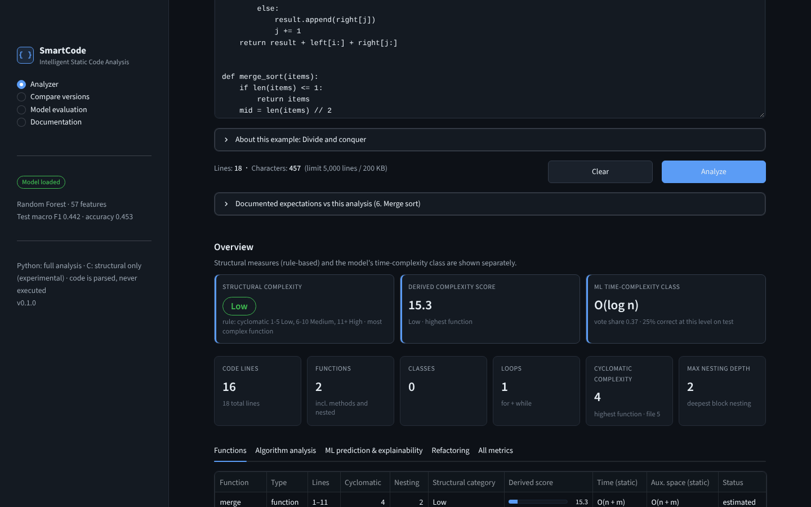
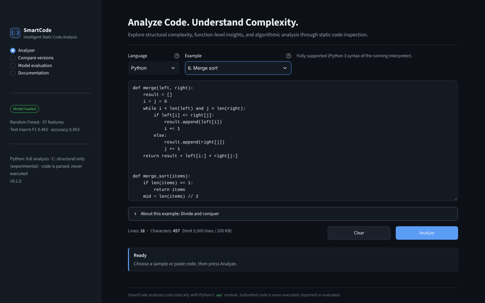
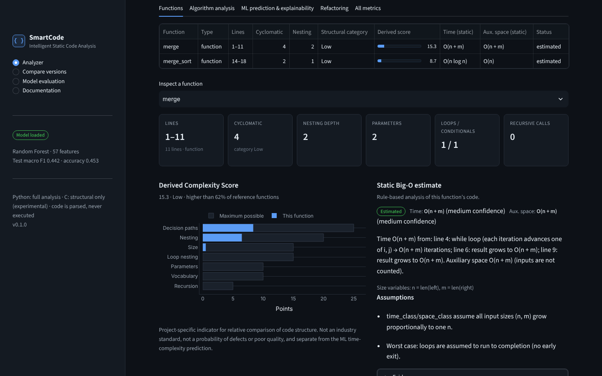
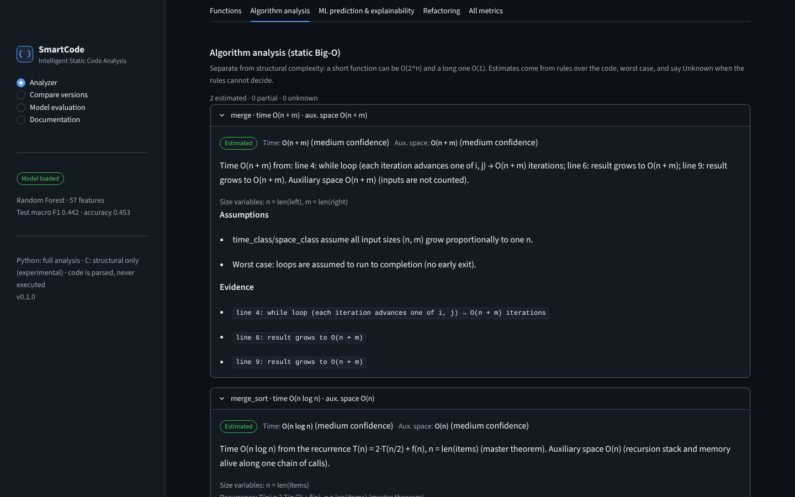
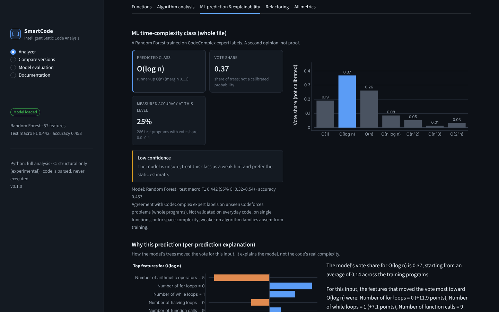
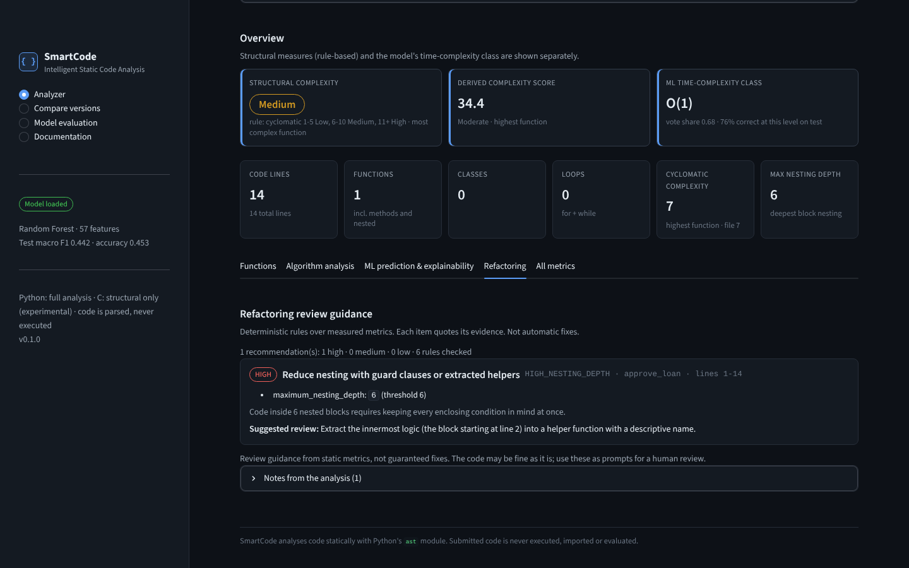
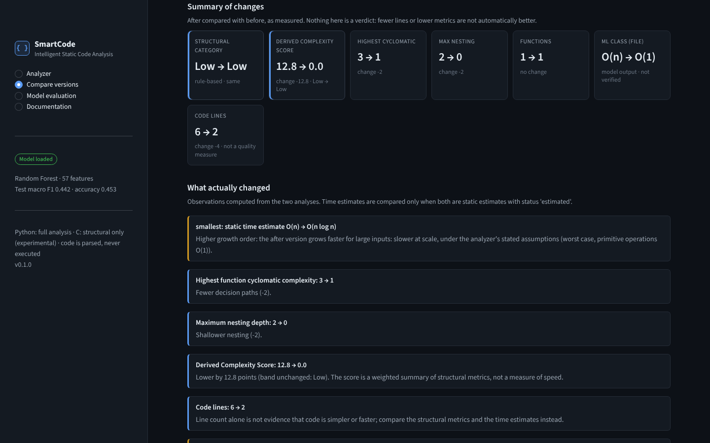
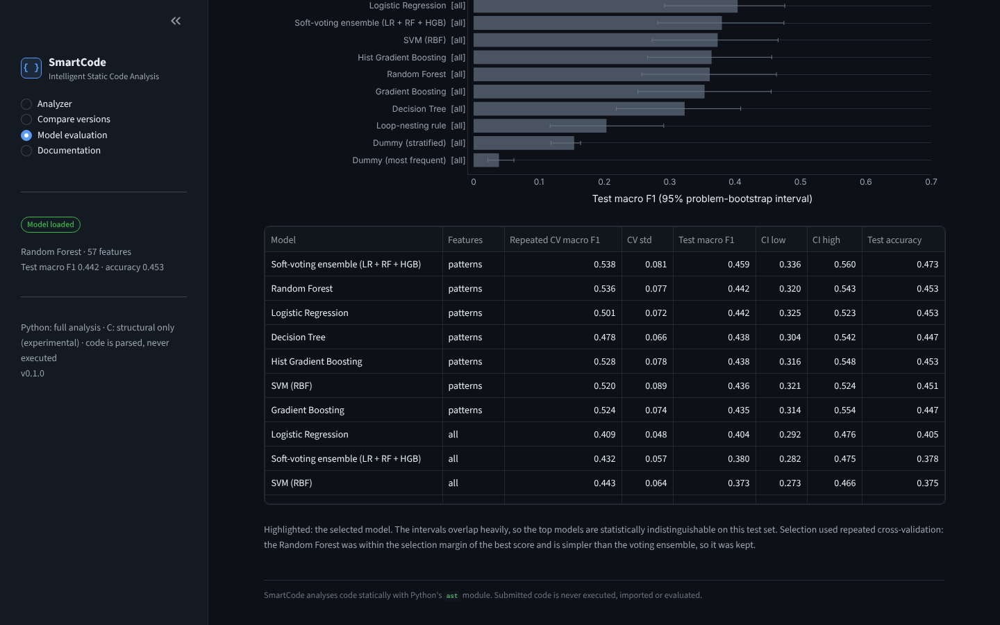
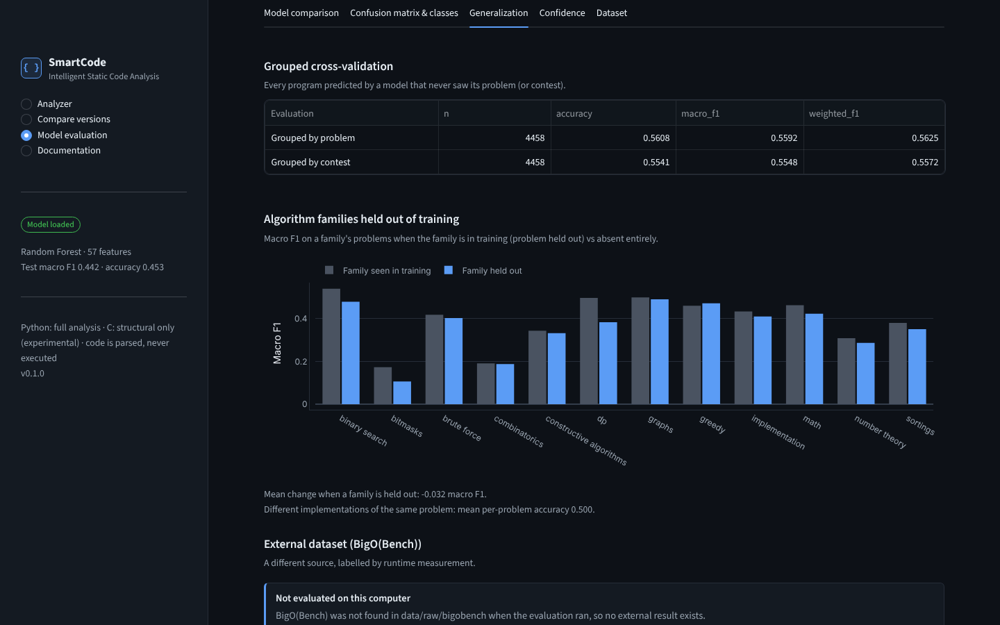
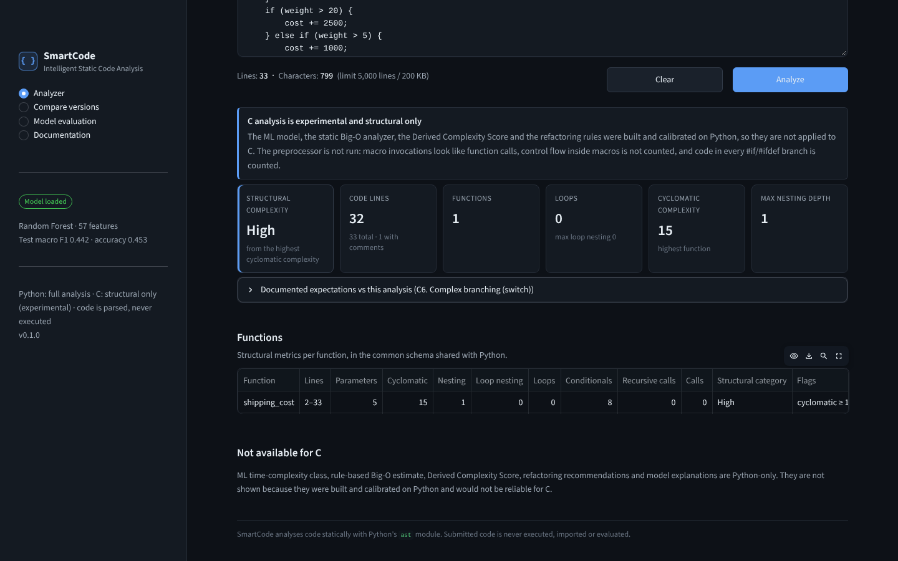

# SmartCode: Smart Code Complexity Predictor

**Static analysis and classical machine learning for code complexity.** SmartCode reads Python source without
running it. It measures structure (cyclomatic complexity, nesting, loops, recursion) for the file and for every
function, estimates time and auxiliary-space Big-O with explicit rules, predicts a time-complexity class with a
Random Forest trained on expert labels, explains that prediction, and suggests what to review. C is supported
experimentally, for structural metrics only.



> **Honest summary.** The rule-based analysis is deterministic and documented. The ML model reaches
> **macro F1 0.442 (95% CI 0.3202–0.5435) and accuracy 0.453** on 814 programs from problems never seen in
> training, over 7 classes. That is well above the baselines (macro F1 0.039–0.203), but roughly half of its
> predictions are wrong. SmartCode shows this uncertainty in the app rather than hiding it.

---

## Contents
1. [Problem statement](#1-problem-statement)
2. [Motivation](#2-motivation)
3. [Features](#3-features)
4. [Architecture](#4-architecture)
5. [Technology stack](#5-technology-stack)
6. [Static-analysis methodology](#6-static-analysis-methodology)
7. [Function-level analysis](#7-function-level-analysis)
8. [Big-O estimation approach](#8-big-o-estimation-approach)
9. [Datasets and licences](#9-datasets-and-licences)
10. [Labeling methodology](#10-labeling-methodology)
11. [Feature engineering](#11-feature-engineering)
12. [ML algorithms compared](#12-ml-algorithms-compared)
13. [Evaluation metrics](#13-evaluation-metrics)
14. [Model comparison results](#14-model-comparison-results)
15. [Generalization experiments](#15-generalization-experiments)
16. [Explainability](#16-explainability)
17. [Refactoring recommendations](#17-refactoring-recommendations)
18. [Installation](#18-installation)
19. [Running the application](#19-running-the-application)
20. [Screenshots](#20-screenshots)
21. [Project structure](#21-project-structure)
22. [Testing](#22-testing)
23. [Limitations](#23-limitations)
24. [Future scope](#24-future-scope)
25. [Security considerations](#25-security-considerations)
26. [Publishing to GitHub](#26-publishing-to-github)

---

## 1. Problem statement

Developers and students need to know two different things about code:

* **How hard is it to follow and test?** That is a structural property: branches, nesting, size.
* **How does its running time grow with input size?** That is its asymptotic (Big-O) complexity.

Both are usually judged by eye. Linters report structural metrics but say nothing about growth rate. Big-O
analysis is done by hand, and a structurally simple function (five lines of recursion) can be exponential.
SmartCode measures the first precisely, estimates the second where the code allows, and reports a learned
second opinion, while keeping these three answers separate and stating how reliable each one is.

## 2. Motivation

* Code review: point reviewers to functions that are hard to follow, with the evidence.
* Learning: show *why* merge sort is O(n log n) and naive Fibonacci is exponential, step by step.
* An honest ML case study: predicting complexity classes from static features is hard. This project measures
  how hard, with grouped splits that prevent the leakage that inflates scores in random splits (section 15).

## 3. Features

| Area | What exists |
|---|---|
| Parsing | Python `ast` + `tokenize`, size limits, friendly errors for syntax, indentation, encoding and depth problems. Code is never executed |
| Structural metrics | 39 file-level metrics. Per function: lines, parameters, loops, conditionals, cyclomatic complexity, nesting, loop nesting, recursion, calls |
| Structural category | Low / Medium / High from cyclomatic complexity (radon thresholds 1–5, 6–10, 11+) |
| Derived Complexity Score | A 0–100 project-specific indicator built from 7 log-scaled metrics, with a percentile among 3,910 reference functions |
| Static Big-O | Rule-based time and auxiliary-space estimates per function, with assumptions, evidence, confidence, and *Unknown* when the rules cannot decide |
| ML prediction | 7-class time-complexity class (O(1) … O(2ⁿ)) for the whole file, plus experimental per-function predictions |
| Explainability | Global permutation importance, grouped importance, and per-prediction tree-path contributions |
| Refactoring guidance | 6 deterministic rules with evidence, severity and a suggested review action |
| Examples | 8 documented Python examples plus 7 C versions, with expected values checked by tests |
| Before/after comparison | Measured differences only. It flags *shorter but slower* changes and never calls a change an improvement |
| Model evaluation page | Saved results: model comparison, confusion matrix, generalization, confidence, dataset |
| Languages | Python: full analysis. **C: experimental, structural metrics only.** C++, Java and JavaScript: not supported |
| Repository analysis | `python -m src.repository FOLDER`: read-only summary of a local folder, with size, time, symlink and secret protections |
| Security | No code execution (proven by tests), model integrity hashes, input limits, HTML escaping, localhost binding |

## 4. Architecture

```
            ┌──────────────── Streamlit UI (app.py, src/ui) ────────────────┐
            │ Analyzer · Compare versions · Model evaluation · Documentation │
            └──────────────┬─────────────────────────────┬──────────────────┘
                           │ Python                      │ C (structural)
                           ▼                             ▼
  code_parser (ast, tokenize, limits)          languages/c_lang (tree-sitter-c)
        │                                              │
        ├─ feature_extractor   39 structural features  └─► common schema (languages/base)
        ├─ pattern_features    18 algorithm patterns          ▲
        ├─ function_analyzer   per-function metrics           │
        ├─ algorithm_analyzer  rule-based Big-O (asymptotics) │  repository/ (scanner, secrets,
        ├─ complexity_score    Derived Complexity Score       │   analyzer) uses only this layer
        ├─ suggestions         refactoring rules              │
        └─ predictor ── model_integrity (SHA-256) ── Random Forest pipeline (models/)
                    └─ explainability (permutation, tree-path)

  Offline pipeline: dataset_loader → eda → preprocessing → train_model → tune_model → evaluate_model → explainability
```

* `predictor.predict()` is the single entry point the UI uses for Python. It returns a JSON-serialisable result
  with metrics, static estimates, the ML class, explanations and recommendations.
* Training is never run at app startup. The UI only loads the saved model, after verifying its hashes.

## 5. Technology stack

| | |
|---|---|
| Language | Python 3.11 (tests also pass on 3.13) |
| Analysis | `ast`, `tokenize` (standard library); `tree-sitter` 0.25.2 + `tree-sitter-c` 0.24.1 for C |
| ML | scikit-learn (model trained with 1.7.2), pandas, NumPy, joblib |
| UI | Streamlit (tested with 1.39 and 1.66), Plotly; Matplotlib for report figures |
| Testing | pytest (940 tests), Streamlit `AppTest` for headless UI tests, Playwright for the screenshots |
| Optional | SHAP (only for a cross-check of explanations; not required) |

No deep learning frameworks and no LLM APIs are used.

## 6. Static-analysis methodology

* **Parsing only.** `ast.parse` builds a syntax tree and `tokenize` gives lines and comments. Nothing is imported,
  compiled to bytecode or executed.
* **Limits first.** Input above 200 KB or 5,000 lines is rejected before parsing. Parser recursion and memory
  errors are reported as *too complex*. Analysis passes are iterative, so deep code cannot overflow the stack.
* **Cyclomatic complexity (McCabe):** 1 + decision points. Each `if`/`elif`, loop, conditional expression,
  `except` handler, comprehension clause, `and`/`or` keyword and non-default `case` counts as one. On 4,651 functions
  of TheAlgorithms/Python, 92.8% get the same value as radon; the differences come from radon counting `assert`
  and loop/`try` `else` clauses.
* **Nesting depth:** the deepest block of `if`/loop/`try`/`with`/`match`. `elif` adds no level.
* **File vs function scope:** each AST node belongs to exactly one function, so the additive counts of a file
  made only of functions equal the sum over its functions (this is tested).
* **Structural category:** a transparent rule on cyclomatic complexity, not a model output.
* **Derived Complexity Score (0–100):** weighted, log-scaled components. The weights are decision paths 0.25,
  nesting 0.20, size 0.15, loop nesting 0.15, parameters 0.10, vocabulary 0.10 and recursion 0.05. It is a
  project-specific indicator for relative comparison, not an industry standard.

## 7. Function-level analysis

Every function, method and nested function gets a stable id from its qualified name (`Graph.bfs`,
`outer.inner`). For each one SmartCode reports:

* line range and length, parameters, loops, conditionals, cyclomatic complexity, nesting, loop nesting,
  recursive calls and calls;
* its structural category and Derived Complexity Score;
* its static Big-O estimate with assumptions and evidence;
* an experimental ML class.

A function's own metrics exclude the bodies of functions nested inside it; those get their own rows.

## 8. Big-O estimation approach

`algorithm_analyzer.py` builds a symbolic cost for each function (`asymptotics.py`). It handles:

* loops over `range` or collections, `while` loops with counters, halving and two pointers;
* recursion, solved with recurrences or the master theorem;
* built-in operations with documented costs, such as `sorted` (n log n), `in` on lists vs sets, and slicing;
* calls to other functions in the same file.

Results are worst case and use the function's own size variables (`n = len(items)`). Each result comes with
assumptions, evidence lines and a confidence level.

When the code is outside the supported patterns, the answer is **Unknown** instead of a guess. Examples are a
`while queue:` loop whose length depends on data, or a call to a library function that receives a whole input
collection (`np.linalg.inv(a)` could be O(n³)).

The 8 documented examples (linear and binary search, nested loops, merge sort, recursive Fibonacci, branching,
deep nesting, arithmetic) state their expected complexity under explicit assumptions. Tests check the analyzer
against them.

## 9. Datasets and licences

| Dataset | Use | Size after cleaning | Licence |
|---|---|---|---|
| [CodeComplex](https://github.com/sybaik1/CodeComplex-Data) (Python subset, commit `c54631d`, SHA-256 verified). Baik et al., [arXiv:2401.08719](https://arxiv.org/abs/2401.08719) | Training and evaluation of the ML model | **4,458 programs** from 275 Codeforces problems | **Not stated in the repository.** Used for non-commercial research. The data is downloaded by the user and never redistributed in this repository; reports contain ids and features, never source code |
| [TheAlgorithms/Python](https://github.com/TheAlgorithms/Python) (commit `6e03a48`) | Reference distribution for the Derived Complexity Score percentiles and validation of the metrics | **3,910 functions** from 1,608 files | MIT |
| [BigO(Bench)](https://huggingface.co/datasets/facebook/BigOBench) time-complexity test set, [arXiv:2503.15242](https://arxiv.org/abs/2503.15242) (optional) | External evaluation only | see section 15 | See the dataset page |

CodeComplex cleaning: 4,900 records, minus 274 exact duplicates, 127 exact duplicates with conflicting labels,
37 renamed duplicates and 4 renamed duplicates with conflicting labels, leaves 4,458. A further 223 near-duplicates
(104 clusters, Jaccard ≥ 0.9) were flagged rather than removed: each cluster is within one problem, and the splits
are by problem.

Class distribution: O(1) 683 (15.3%), O(log n) 581 (13.0%), O(n) 801 (18.0%), O(n log n) 757 (17.0%),
O(n²) 615 (13.8%), O(n³) 540 (12.1%), O(2ⁿ) 481 (10.8%).

## 10. Labeling methodology

* **ML labels** are CodeComplex's expert annotations of each program's **worst-case time complexity**. Its `np`
  class (exponential and harder) is shown as O(2ⁿ). The labels describe whole programs, not single functions.
* **Structural labels** (Low/Medium/High) are not learned. They are a deterministic rule on cyclomatic
  complexity, so training a model on them would only relearn the thresholds. The TheAlgorithms data is
  therefore used as a reference distribution, not as ML ground truth.
* **External labels** (BigO(Bench)) come from runtime measurement, a different method. Only unambiguous
  single-variable classes are mapped, and problems that appear in CodeComplex are excluded.

## 11. Feature engineering

**57 features** (the "patterns" feature set):

* **39 structural features:** lines, comments, functions, classes, `if`/`elif`/`else`, loops, `try`/`except`,
  comprehensions, operators by type, calls, identifiers, cyclomatic complexity, nesting, loop nesting,
  recursion.
* **18 algorithm-pattern features:** sorting and heap calls, halving loops, binary-search midpoints, constant-size
  loops, loops bounded by an outer loop variable, loop depth over input-sized ranges, exponential ranges,
  combinatorics, branching and dividing recursion, memoization, power-of-two expressions, and others.

Preprocessing lives inside scikit-learn pipelines, so nothing from validation or test data leaks into training.
The saved metadata pins the exact feature order, which is checked at load time.

## 12. ML algorithms compared

Ten kinds of model, each on the 39 structural features ("all") and the 57-feature "patterns" set where applicable:

* most-frequent and stratified dummy baselines;
* a hand-written loop-nesting rule;
* Logistic Regression, SVM (RBF kernel) and Decision Tree;
* Random Forest, Gradient Boosting and Histogram Gradient Boosting;
* a soft-voting ensemble (LR + RF + HGB).

Hyperparameters were chosen by grouped cross-validation on the training data. Models were compared by
**repeated grouped cross-validation** (problems never shared between folds). The test set was used once,
for the final report.

## 13. Evaluation metrics

* **Macro F1** (primary): every class counts equally. Accuracy is also reported, alongside balanced accuracy,
  macro precision and recall, and weighted F1.
* **95% confidence interval** for test macro F1, from a bootstrap over *problems* (not rows), because programs
  from one problem are correlated.
* **Confusion matrix and per-class scores**, plus **error distance** (how many classes away an error is).
* **Confidence reliability**: how often predictions at each vote-share level were correct on the test set. The
  app shows this next to every prediction, because forest vote shares are not calibrated probabilities.

## 14. Model comparison results

Test set: 814 programs from problems unseen in training (grouped split: 2,914 train / 730 validation / 814 test).
All values below are copied from `reports/models/model_comparison.csv` and `models/model_metadata.json`.

| Model | Features | Repeated CV macro F1 | Test macro F1 [95% CI] | Test accuracy |
|---|---|---|---|---|
| Dummy (most frequent) | all | 0.0458 | 0.0388 [0.0219–0.0617] | 0.1572 |
| Dummy (stratified) | all | 0.1381 | 0.1538 [0.1183–0.1637] | 0.1560 |
| Loop-nesting rule | all | 0.2655 | 0.2032 [0.1170–0.2908] | 0.2690 |
| Logistic Regression | patterns | 0.5008 | 0.4418 [0.3247–0.5235] | 0.4533 |
| SVM (RBF) | patterns | 0.5202 | 0.4365 [0.3209–0.5245] | 0.4509 |
| Decision Tree | patterns | 0.4776 | 0.4384 [0.3042–0.5423] | 0.4472 |
| **Random Forest (selected)** | patterns | **0.5358** | **0.4422 [0.3202–0.5435]** | **0.4533** |
| Gradient Boosting | patterns | 0.5236 | 0.4347 [0.3139–0.5536] | 0.4472 |
| Hist Gradient Boosting | patterns | 0.5280 | 0.4375 [0.3163–0.5482] | 0.4533 |
| Soft-voting ensemble | patterns | 0.5383 | 0.4591 [0.3363–0.5597] | 0.4730 |
| Random Forest | all (39 structural only) | 0.4243 | 0.3612 [0.2573–0.4632] | 0.3550 |

* **Why Random Forest:** the ensemble's cross-validation score (0.5383) was within the selection tolerance of the
  Random Forest's (0.5358), so the simpler model was kept. The ensemble scored higher on the test set (0.459 vs
  0.442), but the test set was not used for selection, and the intervals overlap almost completely.
* **Pattern features matter:** every model improved when the 18 algorithm-pattern features were added. Random
  Forest test macro F1 went from 0.361 to 0.442.
* **Tuning:** a further tuning round improved cross-validation by only 0.004, below the 0.005 adoption margin,
  so it was not adopted. For transparency: the tuned configuration would have scored 0.4615 on the test set.

**Final model** (Random Forest, 300 trees, `max_features="sqrt"`, `min_samples_leaf=3`,
`class_weight="balanced_subsample"`, trained on 3,644 rows):

| Accuracy | Balanced accuracy | Macro precision | Macro recall | **Macro F1** | Weighted F1 |
|---|---|---|---|---|---|
| 0.4533 | 0.4424 | 0.4797 | 0.4424 | **0.4422** (95% CI 0.3202–0.5435) | 0.4515 |

| Class | O(1) | O(log n) | O(n) | O(n log n) | O(n²) | O(n³) | O(2ⁿ) |
|---|---|---|---|---|---|---|---|
| F1 | 0.443 | 0.433 | 0.439 | 0.629 | 0.370 | 0.377 | 0.405 |
| Test programs | 132 | 113 | 128 | 143 | 100 | 112 | 86 |

* **Errors:** 45.3% correct, 20.4% off by one class, 34.3% off by two or more.
* **Confidence:** predictions with vote share 0.8–1.0 were correct 80.7% of the time (57 programs), 0.6–0.8 75.8%
  (190), 0.4–0.6 38.4% (281), and below 0.4 24.8% (286).

## 15. Generalization experiments

| Experiment | Result |
|---|---|
| Out-of-fold, grouped by **problem** (all 4,458 programs) | accuracy 0.5608, macro F1 0.5592 |
| Out-of-fold, grouped by **contest** (stricter) | accuracy 0.5541, macro F1 0.5548 |
| **Algorithm family held out** of training (12 Codeforces tags) | mean macro F1 change −0.032. Largest drops: dp 0.497 → 0.383, binary search 0.539 → 0.479, bitmasks 0.172 → 0.106 |
| Different implementations of the same unseen problem | mean per-problem accuracy 0.500 |
| **Leakage check**: random vs grouped split | a 1-nearest-neighbour probe scores 57.2% on a random split and 34.6% on a grouped split. Random splits inflate scores by about 22.6 points because solutions to the same problem land in both train and test |
| **External: BigO(Bench)** (different source, runtime-measured labels) | 521 programs from problems not in CodeComplex: accuracy 0.772, macro F1 0.458. *Measured on the development machine with the optional BigO(Bench) file downloaded. It is not part of the default pipeline, so a fresh clone shows "not evaluated" (screenshot 9).* |

The out-of-fold macro F1 (0.559) is higher than the single test split (0.442). The test split has only about 50
problems, so its interval is wide. Both numbers are reported.

To reproduce the external evaluation, place `time_complexity_test_set.jsonl` from the BigO(Bench) dataset in
`data/raw/bigobench/` and re-run `python -m src.evaluate_model`.

## 16. Explainability

* **Global:** permutation importance on the held-out test set (10 repeats).
  * Top features (drop in macro F1 when shuffled): `sort_call_count` 0.093, `power_of_two_expr_count` 0.025 and
    `halving_loop_count` 0.022.
  * Grouped importance: loops 0.185, library calls/data structures 0.105, exponential patterns 0.054, halving
    0.029. Branching, size, nesting and operator features showed no measurable benefit on unseen problems.
* **Per prediction:** tree-path contributions, an exact additive decomposition of the forest's vote, show which
  features moved this prediction and by how much.
* **Caveats:** importance is association, not causation, and the global ranking is not the reason for any
  single prediction. SHAP is supported as an optional cross-check: its top-5 features agree with the tree-path
  method on 4.0 of 5 features on average.

## 17. Refactoring recommendations

Deterministic rules over measured metrics. They use no LLM, and each recommendation quotes its evidence.

| Rule | Fires when |
|---|---|
| `HIGH_CYCLOMATIC_COMPLEXITY` | cyclomatic ≥ 11 (medium), ≥ 21 (high) |
| `HIGH_NESTING_DEPTH` | nesting ≥ 4 (medium), ≥ 6 (high) |
| `LONG_FUNCTION` | ≥ 50 (medium), ≥ 100 (high) code lines |
| `MANY_CONDITIONAL_BRANCHES` | an if/elif chain of 5+ arms or 15+ branches. A lookup table is suggested only when the same value is compared |
| `RECURSION_TERMINATION` / `RECURSION_REPEATED_WORK` / `RECURSION_DEPTH` | a recursive call that runs before any base case can return; two or more recursive calls on shrinking arguments without memoization (repeated subproblems); recursion that shrinks by a constant step, so its depth grows with the input and can exceed CPython's default limit of 1000 |
| `DUPLICATED_STRUCTURE` | near-identical functions (Jaccard ≥ 0.85, 6+ lines) or repeated blocks |

Overlapping advice is merged so that recommendations never contradict each other. They are presented as review
prompts, not guaranteed fixes.

## 18. Installation

Requirements: Windows, macOS or Linux, with **Python 3.11**. The test suite also passes on 3.13; 3.12 has not been tested.

```powershell
# Windows (PowerShell)
git clone YOUR_REPOSITORY_URL smart-code-complexity-predictor
cd smart-code-complexity-predictor
py -3.11 -m venv .venv
.\.venv\Scripts\Activate.ps1
python -m pip install --upgrade pip
pip install -r requirements.txt
```

```bash
# macOS / Linux
git clone YOUR_REPOSITORY_URL smart-code-complexity-predictor
cd smart-code-complexity-predictor
python3.11 -m venv .venv
source .venv/bin/activate
python -m pip install --upgrade pip
pip install -r requirements.txt
```

**Build the datasets and train the model.** These are not in the repository: CodeComplex is not redistributed,
and model pickles should not be downloaded from anyone. The commands download from pinned commits, verify
checksums, train, evaluate, and record the model's SHA-256 hashes.

```bash
python -m src.dataset_loader all     # download and build both datasets
python -m src.eda                    # optional: exploratory figures in reports/eda
python -m src.preprocessing          # grouped train/validation/test split
python -m src.train_model            # compare all models (reports/models)
python -m src.tune_model             # tuning round
python -m src.evaluate_model         # final model, evaluation report, saves models/
python -m src.explainability         # global explanations (models/explainability.json)
python -m src.model_integrity verify # should print OK twice
```

Without a trained model the app still works: all static analysis is available, and the ML panel explains how
to train.

## 19. Running the application

```bash
streamlit run app.py
```

Then open **http://localhost:8501**. The app listens on this computer only. Press Ctrl+C in the terminal to stop it.

Command-line extras:

```bash
python -m src.repository path/to/project --out path/outside/project   # repository summary (read-only)
python -m src.model_integrity verify                                   # check model files
```

## 20. Screenshots

All screenshots are from the running application. They were captured on a machine without the optional
BigO(Bench) file (see screenshot 9).

| | |
|---|---|
|  **1. Analyzer** with documented examples |  **2. Results overview**: structural category, score and ML class kept separate |
|  **3. Function inspection**: score breakdown and static Big-O |  **4. Algorithm analysis** with assumptions and evidence |
|  **5. ML prediction**: vote shares, measured accuracy at this confidence, explanation |  **6. Refactoring guidance** with evidence |
|  **7. Compare versions**: shorter code with a higher time estimate |  **8. Model comparison** with confidence intervals |
|  **9. Generalization experiments** |  **10. Experimental C analysis** (structural only) |

## 21. Project structure

```
smart-code-complexity-predictor/
├── app.py                      Streamlit entry point
├── requirements.txt            pinned dependency ranges
├── pyproject.toml              pytest configuration
├── README.md · SECURITY.md · TESTING.md
├── .streamlit/config.toml      dark theme, no error details, localhost only
├── docs/EXTENSIBILITY.md       languages, C parser choice, repository analysis design
├── notebooks/01_exploratory_data_analysis.ipynb
├── screenshots/                README screenshots
├── data/raw/ · data/processed/ downloaded and built locally (git-ignored)
├── models/                     trained model, metadata, explanations (git-ignored, rebuilt)
├── reports/                    eda/ · preprocessing/ · models/ · evaluation/ · explainability/
├── src/
│   ├── config.py               paths and limits
│   ├── code_parser.py          safe parsing (ast, tokenize), limits, errors
│   ├── feature_extractor.py    39 structural features, file and function level
│   ├── pattern_features.py     18 algorithm-pattern features
│   ├── function_analyzer.py    per-function metrics
│   ├── asymptotics.py          symbolic cost algebra
│   ├── algorithm_analyzer.py   rule-based Big-O
│   ├── complexity_score.py     Derived Complexity Score
│   ├── suggestions.py          refactoring rules
│   ├── dataset_loader.py · eda.py · preprocessing.py
│   ├── train_model.py · tune_model.py · evaluate_model.py
│   ├── explainability.py       permutation and tree-path explanations
│   ├── model_integrity.py      SHA-256 verification before unpickling
│   ├── predictor.py            single entry point used by the UI
│   ├── examples.py · comparison.py   documented examples, before/after comparison
│   ├── languages/              common schema, registry, Python adapter, C analyzer (tree-sitter)
│   ├── repository/             safe folder scan, secret detection, summary, CLI
│   └── ui/                     components, styles, charts, services, views/
└── tests/                      24 test files, 940 tests (+ conftest.py)
```

## 22. Testing

```bash
python -m pytest
```

* 940 tests cover the parser, features, Big-O rules, ML pipeline, model loading and integrity, explainability,
  recommendations, examples, comparison, the Streamlit pages (headless), languages, repository analysis,
  security and robustness. Line coverage is 92% of `src/` and `app.py`, measured with `pytest-cov` (not a
  project requirement).
* Expected result on Windows: **936 passed, 4 skipped**. The skips are the SHAP cross-check when SHAP is not
  installed, two symlink tests (Windows only allows symlinks with Developer Mode on), and one POSIX-only
  named-pipe test.
* [TESTING.md](TESTING.md) maps tests to requirements and gives a 17-step manual test checklist.

## 23. Limitations

* **ML accuracy is modest:** macro F1 0.442 on unseen problems, with a wide interval (0.3202–0.5435). Treat the
  class as a second opinion. The app shows the measured accuracy at each confidence level.
* **Domain:** trained on short competitive-programming solutions from one source (Codeforces). It has not been
  validated on application code, on single functions (per-function predictions are experimental), or for space
  complexity.
* **Labels:** expert labels are imperfect, and static features cannot see data-dependent loop bounds.
* **Static Big-O** covers common patterns only. Everything else is reported as Unknown, and estimates are worst
  case.
* **Structural metrics** describe control flow and size, not naming, cohesion, coupling, tests or documentation.
* **C** is experimental and structural only. The preprocessor is not run, and code that relies on
  syntax-changing macros is refused. **C++, Java and JavaScript are not supported.**
* **CodeComplex licence** is not stated by its authors, so its data is not redistributed here.

## 24. Future scope

* More training sources (BigO(Bench) in training, textbook implementations) and function-level labels.
* Space-complexity labels and evaluation.
* Further languages through the documented interface in `docs/EXTENSIBILITY.md`, each starting as
  structural-only.
* A repository page in the app, and incremental analysis of changed files.
* Calibrated probabilities (for example isotonic calibration on grouped folds).

## 25. Security considerations

* **Submitted code is never executed.** Only `ast.parse` and `tokenize` read it. The tests analyse 15 hostile
  programs (process kill, infinite loop, shell, file writes, `exec`/`eval`, dynamic imports) with those operations
  trapped, and confirm nothing runs.
* **Model pickles are verified before loading.** The SHA-256 hash recorded at training time must match, the file
  must be a regular file, and it must be under 512 MB. A planted malicious pickle is refused, as tested. This is
  integrity checking, not authentication.
* Input limits (200 KB, 5,000 lines), parser failures reported as messages, and HTML-escaped output.
* The app has no upload widget and no tracebacks in the page, and it listens on `localhost` only. Streamlit usage
  statistics are off.
* **Repository analysis** is read-only, never follows symlinks, refuses paths outside the folder, enforces size and
  time limits, never opens credential files, skips files that look like they contain secrets, and never puts source
  text or secret values into reports.
* No network access at runtime. Dataset downloads use pinned URLs with checksum verification and zip-slip
  protection.
* Full review: [SECURITY.md](SECURITY.md).

## 26. Publishing to GitHub

**First check whether the folder is already a Git repository or has a remote.** Never overwrite existing
history or remotes without checking.

```bash
git status            # "not a git repository" means it is safe to run git init
git remote -v         # an empty result means no remote is configured yet
git log --oneline -5  # shows existing history, if any
```

**New repository** (no `.git` folder yet):

```bash
git init -b main
git add .
git commit -m "Initial commit: Smart Code Complexity Predictor"
git remote add origin YOUR_REPOSITORY_URL
git push -u origin main
```

**Existing repository** (history already present): do not run `git init`. Keep the history, and only add a remote
if `git remote -v` printed nothing:

```bash
git branch -M main                          # optional: rename the current branch to main
git remote add origin YOUR_REPOSITORY_URL   # only if no remote exists
git push -u origin main
```

Before pushing, confirm that nothing private or generated is tracked:

```bash
git ls-files .venv models data/raw data/processed reports/repository   # should print nothing
```

---

*SmartCode is an educational project. Its complexity estimates support human judgement; they do not replace it.*
