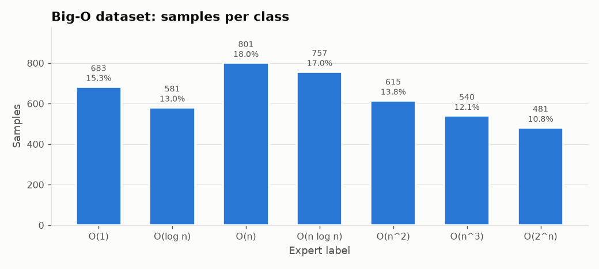
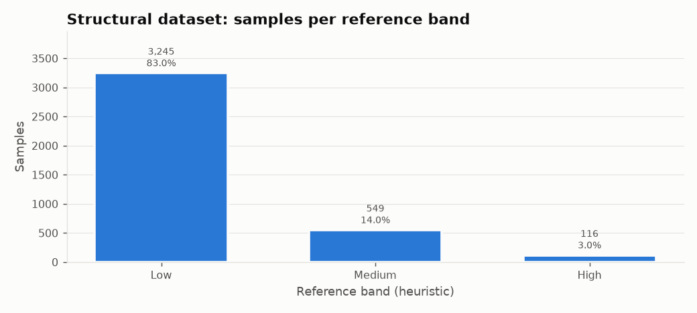
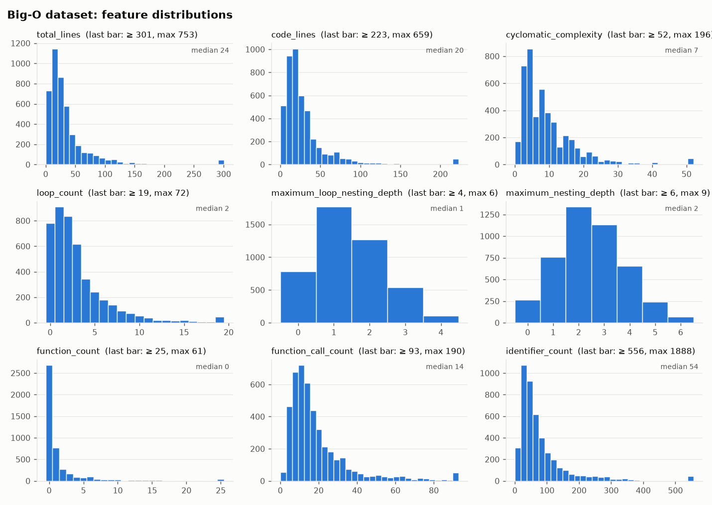
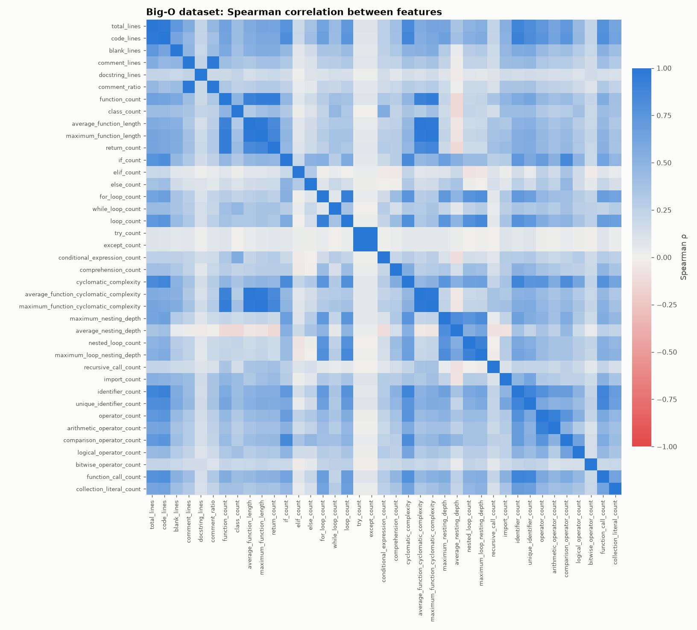
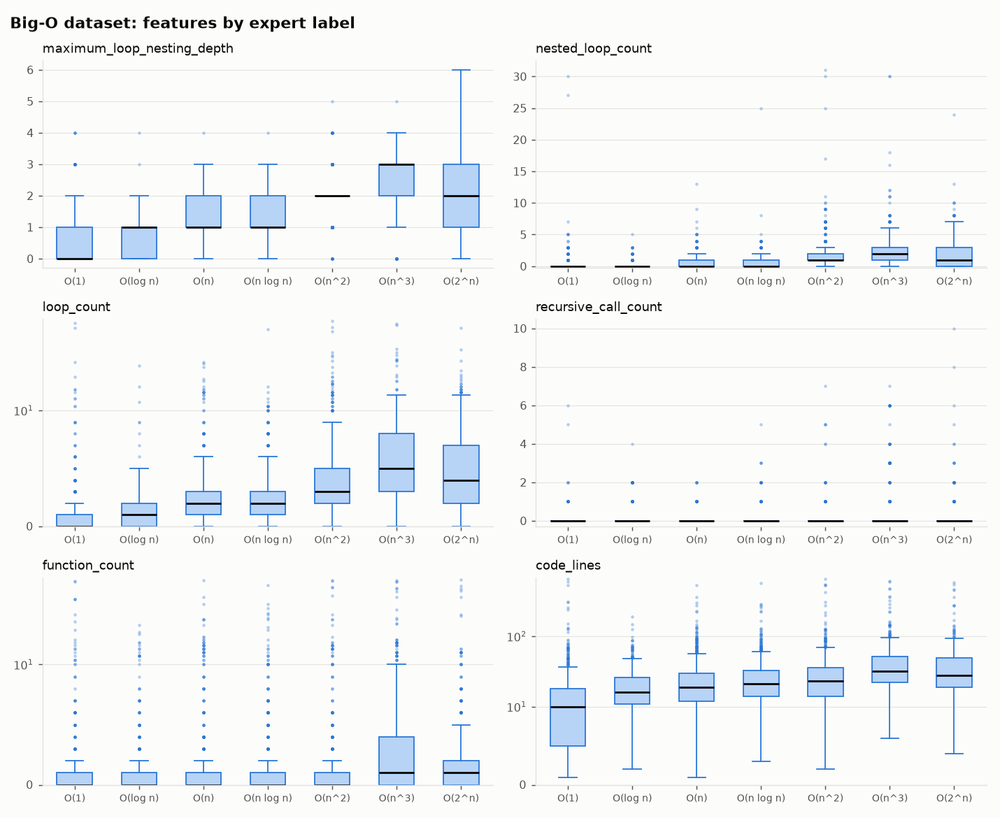
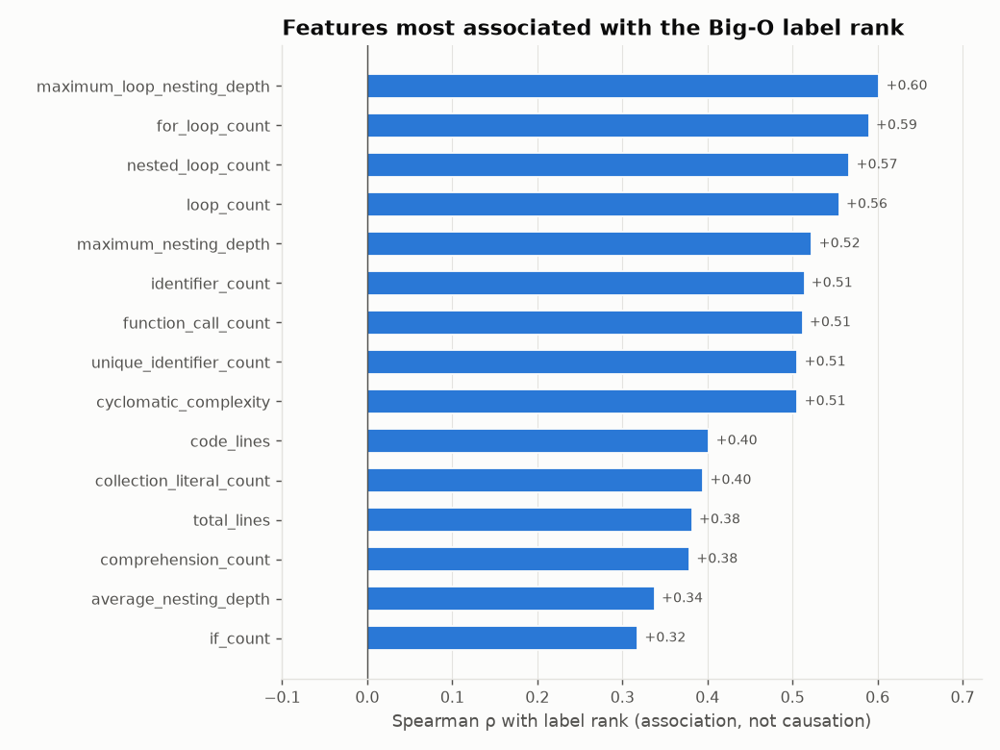
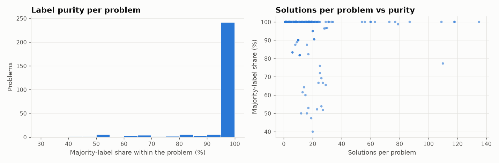
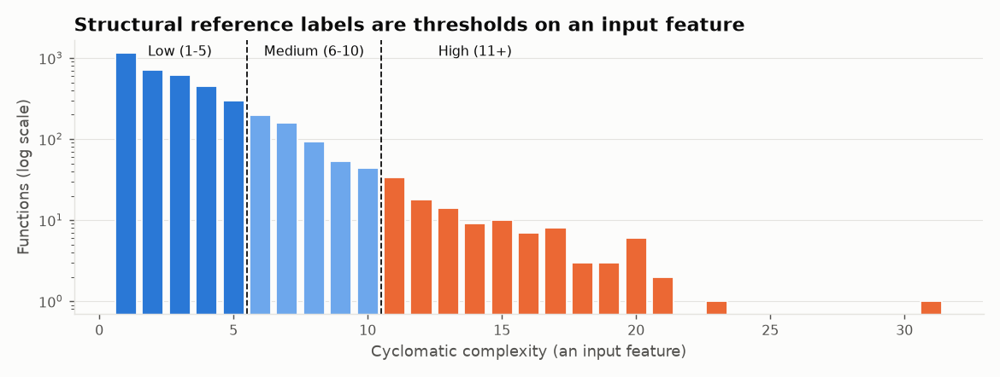
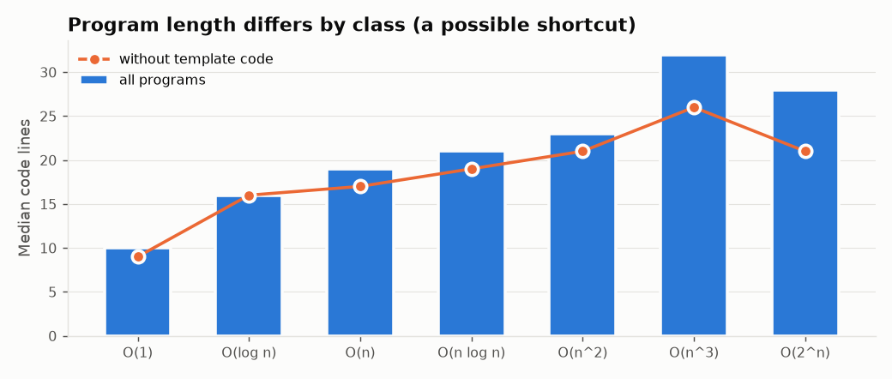

# Exploratory data analysis

Generated by `python -m src.eda` from `data/processed/`. Every number below is computed from the processed
datasets. Correlations describe associations in this data; they do not show that a feature causes a label.

## 1–3. Dimensions, types, missing values

| Dataset | Rows | Columns | Features | Feature dtypes | Missing feature values |
| --- | ---: | ---: | ---: | --- | ---: |
| Big-O (CodeComplex) | 4,458 | 52 | 39 | {'int64': 35, 'float64': 4} | 0 |
| Structural (TheAlgorithms) | 3,910 | 48 | 36 | {'int64': 34, 'float64': 2} | 0 |

Empty metadata strings (not missing features): none. Constant features: none. Features that are 0 in more than 95% of programs: docstring_lines, try_count, except_count.

## 4. Duplicates

| Check | Big-O | Structural |
| --- | ---: | ---: |
| Duplicate sample ids | 0 | 0 |
| Duplicate code hashes | 0 | 0 |
| Rows sharing an identical feature vector | 95 | 221 |
| Identical feature vectors with different labels | 0 | 0 |
| Highest accuracy achievable from these features | 100.0% | 100.0% |

Different programs can share a feature vector (the features summarise structure, not the code). None of these
collisions carry conflicting labels, so the features do not cap achievable accuracy below 100% on this data.

## 5. Class distribution

| class | count | percent |
| --- | ---: | ---: |
| O(1) | 683 | 15.32 |
| O(log n) | 581 | 13.03 |
| O(n) | 801 | 17.97 |
| O(n log n) | 757 | 16.98 |
| O(n^2) | 615 | 13.8 |
| O(n^3) | 540 | 12.11 |
| O(2^n) | 481 | 10.79 |

The Big-O classes are mildly imbalanced (largest/smallest share = 1.67).

| band | count | percent |
| --- | ---: | ---: |
| Low | 3,245 | 82.99 |
| Medium | 549 | 14.04 |
| High | 116 | 2.97 |

The structural bands are heavily imbalanced: only 2.97% of functions fall in High.

## 6. Feature distributions

Count features are right-skewed with long tails; each histogram shows values up to the 99th percentile, and the last bar collects the top 1%.

| feature | mean | median | std | min | max | zero_% | skew |
| --- | ---: | ---: | ---: | ---: | ---: | ---: | ---: |
| total_lines | 38.63 | 24 | 58.7 | 1 | 753 | 0 | 6.51 |
| code_lines | 30.81 | 20 | 45.38 | 1 | 659 | 0 | 7.53 |
| cyclomatic_complexity | 9.91 | 7 | 12.09 | 1 | 196 | 0 | 7.5 |
| loop_count | 3.24 | 2 | 4.62 | 0 | 72 | 17.52 | 6.4 |
| maximum_loop_nesting_depth | 1.42 | 1 | 0.99 | 0 | 6 | 17.52 | 0.48 |
| maximum_nesting_depth | 2.49 | 2 | 1.35 | 0 | 9 | 5.88 | 0.39 |
| function_count | 1.79 | 0 | 5.12 | 0 | 61 | 60.18 | 6.6 |
| function_call_count | 19.38 | 14 | 19.06 | 1 | 190 | 0 | 4.04 |
| identifier_count | 86.28 | 54 | 129.22 | 1 | 1,888 | 0 | 7.47 |

## 7. Correlation between features

9 feature pairs have |Spearman ρ| ≥ 0.95. Several are redundant by definition
(`loop_count = for_loop_count + while_loop_count`, `operator_count` is a sum of categories,
`comment_ratio` is derived from `comment_lines`). Linear models need one of each pair removed or regularisation.

| feature_a | feature_b | spearman |
| --- | --- | ---: |
| try_count | except_count | 1 |
| average_function_length | average_function_cyclomatic_complexity | 0.99 |
| maximum_function_length | maximum_function_cyclomatic_complexity | 0.99 |
| average_function_cyclomatic_complexity | maximum_function_cyclomatic_complexity | 0.98 |
| average_function_length | maximum_function_length | 0.98 |
| comment_lines | comment_ratio | 0.98 |
| average_function_length | maximum_function_cyclomatic_complexity | 0.98 |
| maximum_function_length | average_function_cyclomatic_complexity | 0.97 |
| total_lines | code_lines | 0.97 |

## 8. Outliers

Values beyond Q3 + 3·IQR. Features with IQR = 0 are mostly zero, so any non-zero value is flagged there.

| feature | outliers | outlier_% | q1 | q3 | iqr | max |
| --- | ---: | ---: | ---: | ---: | ---: | ---: |
| elif_count | 635 | 14.24 | 0 | 0 | 0 | 21 |
| bitwise_operator_count | 605 | 13.57 | 0 | 0 | 0 | 49 |
| conditional_expression_count | 515 | 11.55 | 0 | 0 | 0 | 6 |
| function_count | 482 | 10.81 | 0 | 1 | 1 | 61 |
| import_count | 473 | 10.61 | 0 | 1 | 1 | 40 |
| comment_lines | 429 | 9.62 | 0 | 1 | 1 | 92 |
| class_count | 325 | 7.29 | 0 | 0 | 0 | 12 |
| recursive_call_count | 314 | 7.04 | 0 | 0 | 0 | 10 |
| comment_ratio | 289 | 6.48 | 0 | 0.04 | 0.04 | 0.97 |
| logical_operator_count | 239 | 5.36 | 0 | 1 | 1 | 67 |

The longest programs (753 lines) consist mostly of template classes, not algorithmic code.
Outliers are kept (they are real submissions); tree models are robust to them, and linear models should use
log-transformed or scaled features.

## 9. Relationship between features and labels

The strongest association is `maximum_loop_nesting_depth` (ρ = +0.60). Loop-nesting features rise with the label rank as
algorithm theory would suggest, but the overlap between classes is large: no single feature separates them.

`recursive_call_count` has median 0 in every class: only 12.5% of O(2^n) programs contain a direct
recursive call; most enumerate subsets with loops over bitmasks (see the tag table in section 10).

Median values per class:

| feature | O(1) | O(log n) | O(n) | O(n log n) | O(n^2) | O(n^3) | O(2^n) |
| --- | ---: | ---: | ---: | ---: | ---: | ---: | ---: |
| maximum_loop_nesting_depth | 0 | 1 | 1 | 1 | 2 | 3 | 2 |
| nested_loop_count | 0 | 0 | 0 | 0 | 1 | 2 | 1 |
| loop_count | 0 | 1 | 2 | 2 | 3 | 5 | 4 |
| recursive_call_count | 0 | 0 | 0 | 0 | 0 | 0 | 0 |
| function_count | 0 | 0 | 0 | 0 | 0 | 1 | 1 |
| code_lines | 10 | 16 | 19 | 21 | 23 | 32 | 28 |

## 10. Potential target leakage

- **Problem identity.** 236 of 275 problems (85.8%) have the same label for every solution, and 95.6% of samples carry their problem's majority label. If solutions of the same problem appear in both training and test data, a model can score well by
  recognising the problem rather than the complexity. **Training and evaluation must split by `problem`.**
- **Tags.** Problem tags are strongly associated with labels (table below), but they are Codeforces metadata
  that user code does not have. They are excluded from the features.
- **Metadata columns** (`sample_id`, `raw_index`, `code_sha256`, `near_duplicate_cluster`, `label_*`) must never be
  used as features.
- **Structural labels are circular.** The reference band is reproduced by a threshold rule on
  `cyclomatic_complexity` for 100.0% of functions, and that column is an input feature. A
  model trained on these labels would only relearn the thresholds; removing the column does not fix it,
  because other features are strongly correlated with it: `maximum_nesting_depth` (0.829), `average_nesting_depth` (0.82), `if_count` (0.801), `comparison_operator_count` (0.704).

Share of each tag's solutions per label (%), top tags:

| tag | O(1) | O(log n) | O(n) | O(n log n) | O(n^2) | O(n^3) | O(2^n) |
| --- | ---: | ---: | ---: | ---: | ---: | ---: | ---: |
| binary search | 6.6 | 50.2 | 8.3 | 17.4 | 3.1 | 0 | 14.4 |
| bitmasks | 0 | 17.9 | 1.6 | 0 | 5.1 | 0.6 | 74.7 |
| brute force | 15.6 | 16.2 | 10.5 | 12 | 13 | 7.6 | 25.1 |
| combinatorics | 0 | 0 | 13.1 | 8.5 | 3 | 20.6 | 54.8 |
| constructive algorithms | 15.1 | 12.3 | 30.4 | 8.7 | 30.2 | 0 | 3.4 |
| dp | 3.5 | 13.2 | 9.1 | 3.3 | 11.6 | 36.4 | 22.9 |
| graphs | 5.6 | 0 | 14.7 | 12.7 | 16.2 | 37.2 | 13.6 |
| greedy | 4.5 | 8.7 | 23.4 | 26 | 10.3 | 25.4 | 1.7 |
| implementation | 17.5 | 13.7 | 24.8 | 19.2 | 23.9 | 0.1 | 0.9 |
| math | 25.2 | 30.6 | 14 | 9.4 | 9.3 | 3.5 | 8.1 |
| number theory | 75.1 | 1.3 | 7.6 | 0 | 0 | 5.9 | 10.1 |
| sortings | 0.2 | 0 | 8.5 | 62 | 1.5 | 19.6 | 8.3 |

## 11. Near-duplicate samples

223 samples in 104 clusters (largest: 5); 0 clusters have mixed labels and 0 span more than one problem.
Because every cluster stays inside one problem, a problem-level split keeps near-duplicates on one side.

## 12. Possible dataset bias

- **One source and one style.** All programs are Codeforces solutions: short, single-file, reading from standard
  input. Real-world code (classes, libraries, I/O, frameworks) is under-represented.
- **Whole-program labels.** Labels describe complete programs, while the app analyses functions.
- **Problem concentration.** 275 problems supply 4,458 samples (median 11, max 135 per problem), so the effective diversity is closer to 275 tasks than to 4,458.
- **Template code.** 20.2% of programs read `sys.stdin` directly, from 10.5% of O(1) to 35.7% of O(n^3) programs. Template code inflates size features (lines, classes, functions) independently of the algorithm, so size can act as a shortcut that reflects author style.

| template pattern (% of class) | O(1) | O(log n) | O(n) | O(n log n) | O(n^2) | O(n^3) | O(2^n) | all |
| --- | ---: | ---: | ---: | ---: | ---: | ---: | ---: | ---: |
| reads sys.stdin | 10.5 | 11.2 | 16.2 | 19.6 | 23.3 | 35.7 | 31.2 | 20.2 |
| FastIO class | 2.3 | 2.6 | 3.6 | 4 | 3.9 | 12 | 8.5 | 4.9 |
| raises recursion limit | 3.4 | 3.6 | 3.7 | 3.6 | 3.9 | 8.7 | 6.9 | 4.6 |

- **Label noise.** Phase 7 removed 131 records whose identical code carried different expert labels; similar
  disagreements likely remain in non-identical code.
- **Structural corpus.** TheAlgorithms/Python is educational code: small, well-documented functions, so
  High-complexity functions are rare (2.97%).

## Assessment: is the data suitable for training?

**Big-O dataset: suitable, with conditions.** It has 4,000+ expert-labelled real programs, seven reasonably balanced
classes, no missing values, no conflicting duplicates, and features whose association with the label is
plausible (loop nesting rises from O(1) to O(n^3)). Conditions for honest results:

1. Split by problem (grouped cross-validation and a held-out set of problems); report random-split scores only
   to show how much they overestimate.
2. Exclude tags and all metadata columns from the features.
3. Compare against simple baselines: majority class, a single loop-nesting rule, and the Phase 6 static analyser.
4. Check whether size features act as a shortcut, by training with and without them.
5. Describe results as "agreement with expert labels on Codeforces-style programs", not general Big-O accuracy,
   and remember that labels are per program while the app predicts per function.

**Structural dataset: not suitable as a supervised target.** Its labels are thresholds on an input feature, so
training would only reproduce the rule. It is suitable for describing distributions and for calibrating the
transparent rule-based structural score.
