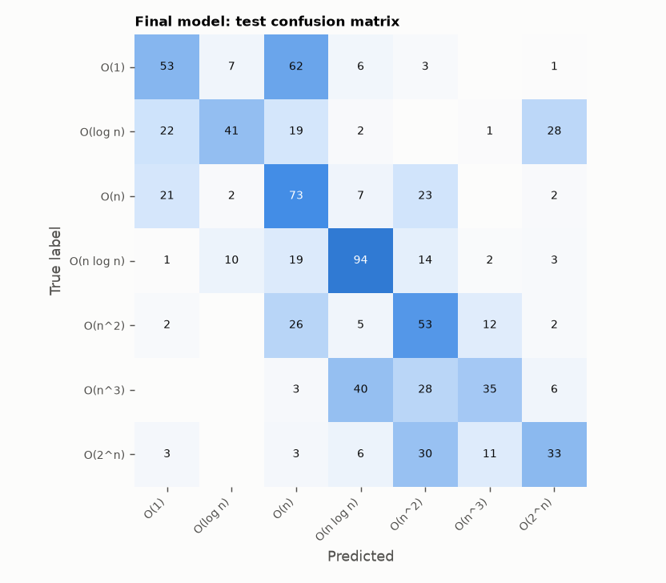
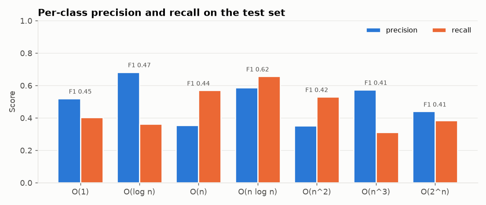
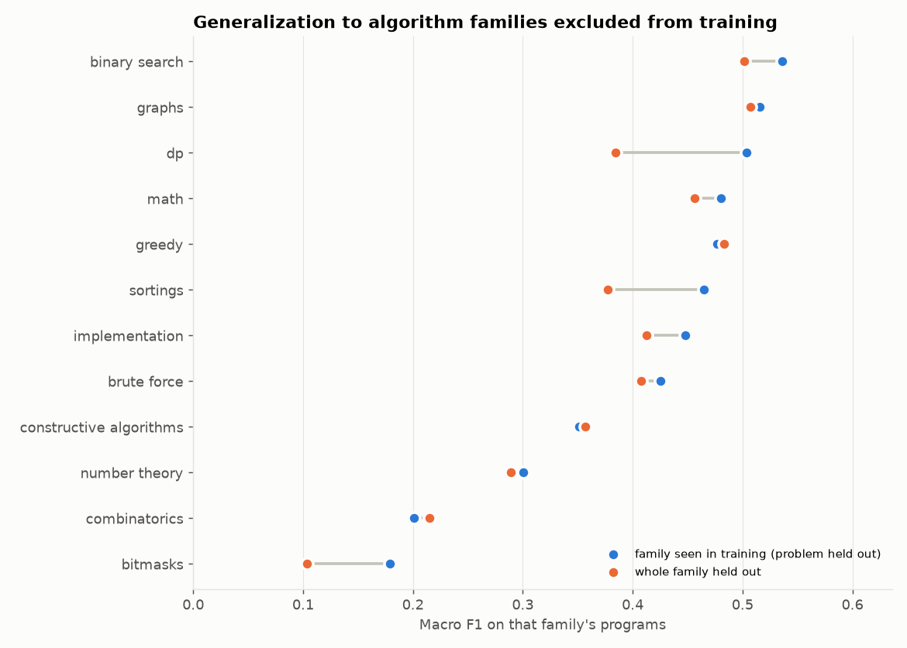
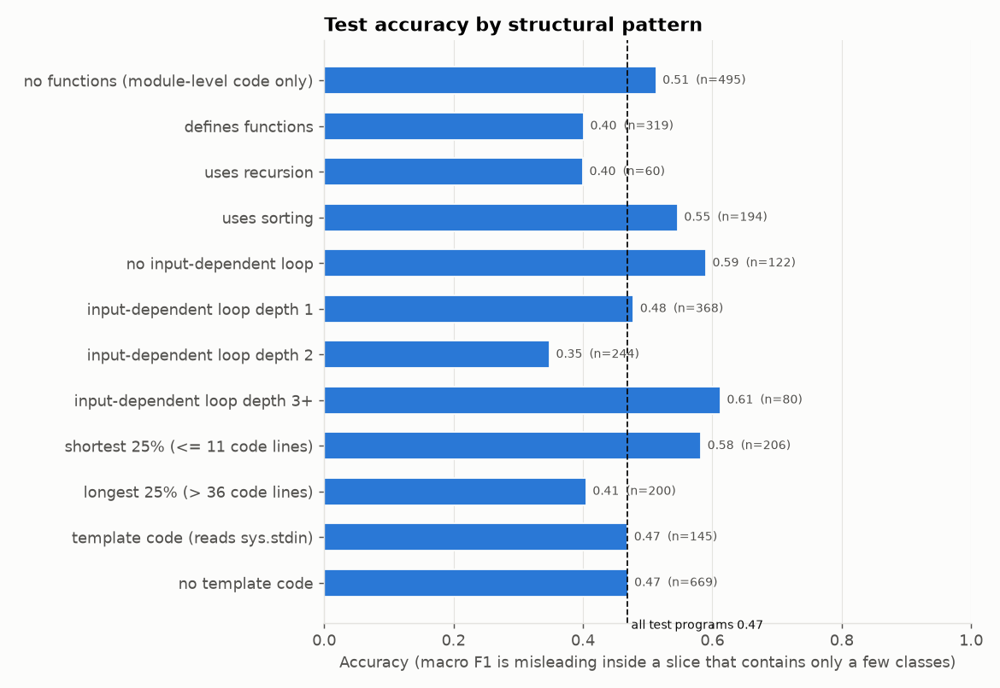

# Tuning and generalization

Generated by `python -m src.tune_model` and `python -m src.evaluate_model` (seed 42). All numbers are measured; the test set was used once, after tuning.

## 1. Tuning (Random Forest)

RandomizedSearchCV, 30 configurations per feature set, grouped 5-fold CV on
train + validation (test untouched). Before/after compared on the Phase 10 repeated grouped CV folds.

| | Feature set | Repeated-CV macro F1 | Test macro F1 | Test accuracy |
| --- | --- | ---: | ---: | ---: |
| Before (Phase 10) | patterns_static | 0.556 ± 0.080 | 0.460 | 0.469 |
| After tuning | patterns_static_no_size | 0.559 ± 0.073 | 0.488 | 0.494 |

Best search score per feature set: `patterns_static` 0.544 ± 0.083; `patterns_static_no_size` 0.551 ± 0.085.
Tuned parameters: `{"n_estimators": 600, "min_samples_split": 10, "min_samples_leaf": 3, "max_samples": null, "max_features": "log2", "max_depth": 20, "criterion": "entropy", "class_weight": "balanced_subsample"}`.

**Decision: the Phase 10 configuration was kept.** The rule, fixed before testing, adopts the tuned model only if it improves repeated-CV macro F1 by more than 0.005; the change was +0.003. The tuned score is slightly optimistic because
tuning used the same rows. Both test scores are shown for transparency; they did not influence the decision.

## 2. Final model on the test set

Configuration: Random Forest, `patterns_static` features, `{"class_weight": "balanced_subsample", "max_features": "sqrt", "min_samples_leaf": 3, "n_estimators": 300}`;
trained on 3,644 train + validation rows; tested once on 814 rows from unseen problems.

| Accuracy | Balanced acc. | Macro precision | Macro recall | Macro F1 [95% CI] | Weighted F1 |
| ---: | ---: | ---: | ---: | ---: | ---: |
| 0.469 | 0.460 | 0.502 | 0.460 | 0.460 [0.336, 0.558] | 0.468 |

| class | precision | recall | f1 | support |
| --- | ---: | ---: | ---: | ---: |
| O(1) | 0.52 | 0.4 | 0.45 | 132 |
| O(log n) | 0.68 | 0.36 | 0.47 | 113 |
| O(n) | 0.36 | 0.57 | 0.44 | 128 |
| O(n log n) | 0.59 | 0.66 | 0.62 | 143 |
| O(n^2) | 0.35 | 0.53 | 0.42 | 100 |
| O(n^3) | 0.57 | 0.31 | 0.41 | 112 |
| O(2^n) | 0.44 | 0.38 | 0.41 | 86 |

### Confidence is not calibrated probability

The app shows the forest's top vote share as a confidence score. Measured on the test set:

| ECE (top label, 10 bins) | Multiclass Brier | Log loss | Mean top vote share | Accuracy |
| ---: | ---: | ---: | ---: | ---: |
| 0.074 | 0.661 | 1.450 | 0.513 | 0.469 |

ECE is the average gap between the vote share and how often such predictions were right; 0 would be
perfectly calibrated. No calibration step (e.g. isotonic regression) is applied, so vote shares are
reported as confidence scores, together with the measured accuracy per vote-share range.

## 3. Generalization

### a. Different implementations of familiar algorithm families

Every test problem is unseen, but its algorithm families also occur in training. Across 48 test problems with 3+ solutions, the mean per-problem accuracy is 0.521; 9 problems had every solution right and 8 had every solution wrong. On average 73% of a
problem's solutions receive the same prediction (10 problems got a
single prediction for all solutions). Different implementations of one algorithm are therefore usually, but not always,
classified alike, and when the model is wrong about a problem it tends to be wrong for most of its solutions.

Test results by algorithm family (tags; a program can have several). Families with few test problems
(see the column) give unstable numbers, and macro F1 within one family is low because each family
covers only a few classes:

| family | n | test_problems | accuracy | macro_f1 |
| --- | ---: | ---: | ---: | ---: |
| binary search | 76 | 6 | 0.55 | 0.26 |
| bitmasks | 195 | 10 | 0.36 | 0.14 |
| brute force | 122 | 9 | 0.47 | 0.36 |
| combinatorics | 59 | 6 | 0.49 | 0.21 |
| constructive algorithms | 38 | 4 | 0.42 | 0.29 |
| dp | 303 | 14 | 0.34 | 0.24 |
| graphs | 44 | 6 | 0.43 | 0.45 |
| greedy | 280 | 11 | 0.43 | 0.31 |
| implementation | 376 | 20 | 0.53 | 0.42 |
| math | 315 | 16 | 0.41 | 0.38 |
| number theory | 39 | 2 | 0.05 | 0.08 |
| sortings | 55 | 3 | 0.98 | 0.5 |

### b. Excluded source groups

All CodeComplex programs come from Codeforces, so a true source or repository hold-out is not possible inside
this dataset. Out-of-fold predictions over the whole dataset (5 folds, Random Forest re-fitted per fold):

| Held out together | Accuracy | Macro F1 |
| --- | ---: | ---: |
| Problems | 0.573 | 0.571 |
| Contests (whole rounds) | 0.566 | 0.566 |

Holding out whole contests instead of single problems changes macro F1 by -0.005, so problems from the same round
do not leak much information to each other.

Note that this cross-validated estimate over **all** problems (0.571) differs from the
single held-out test set (0.460). Both measure unseen problems; the difference shows how much the score
depends on *which* problems are tested (a few problems contribute many solutions). The honest summary is a range,
roughly 0.46–0.57 macro F1, not a single number.

**External dataset:** BigO(Bench) was not found in `data/raw/bigobench/`, so no cross-source evaluation was run.
Download it (see the commands in the project notes) and rerun `python -m src.evaluate_model` to add it.

### c. Algorithm families excluded from training

For each family, the model is trained on every problem without that tag and tested on the problems with it, and
compared with the same rows predicted when the family is present in training (problem held out).

| family | rows | problems | macro F1 (family seen) | macro F1 (family held out) | change | accuracy (held out) |
| --- | ---: | ---: | ---: | ---: | ---: | ---: |
| dp | 1,276 | 68 | 0.5 | 0.38 | -0.12 | 0.36 |
| sortings | 603 | 32 | 0.46 | 0.38 | -0.09 | 0.7 |
| bitmasks | 624 | 39 | 0.18 | 0.1 | -0.08 | 0.1 |
| implementation | 1,638 | 105 | 0.45 | 0.41 | -0.04 | 0.54 |
| binary search | 576 | 26 | 0.54 | 0.5 | -0.03 | 0.64 |
| math | 1,598 | 86 | 0.48 | 0.46 | -0.02 | 0.49 |
| brute force | 902 | 46 | 0.43 | 0.41 | -0.02 | 0.44 |
| number theory | 237 | 19 | 0.3 | 0.29 | -0.01 | 0.46 |
| graphs | 339 | 22 | 0.52 | 0.51 | -0.01 | 0.6 |
| constructive algorithms | 358 | 25 | 0.35 | 0.36 | 0.01 | 0.48 |
| greedy | 1,271 | 76 | 0.48 | 0.48 | 0.01 | 0.58 |
| combinatorics | 199 | 16 | 0.2 | 0.21 | 0.01 | 0.28 |

Holding out a family changes macro F1 by -0.032 on average; the largest drop is for **dp** (-0.119).
A drop shows that part of the performance relies on having seen similar algorithms. Because tags are tied to labels,
holding out a family also removes many examples of its typical class (for example, bitmasks are mostly O(2^n)).

### d. Different structural patterns (test set)

| slice | n | accuracy | macro_f1 | weighted_f1 |
| --- | ---: | ---: | ---: | ---: |
| all test programs | 814 | 0.47 | 0.46 | 0.47 |
| no functions (module-level code only) | 495 | 0.51 | 0.48 | 0.51 |
| defines functions | 319 | 0.4 | 0.39 | 0.4 |
| uses recursion | 60 | 0.4 | 0.37 | 0.45 |
| uses sorting | 194 | 0.55 | 0.22 | 0.48 |
| no input-dependent loop | 122 | 0.59 | 0.34 | 0.51 |
| input-dependent loop depth 1 | 368 | 0.48 | 0.3 | 0.44 |
| input-dependent loop depth 2 | 244 | 0.35 | 0.25 | 0.3 |
| input-dependent loop depth 3+ | 80 | 0.61 | 0.25 | 0.57 |
| shortest 25% (<= 11 code lines) | 206 | 0.58 | 0.42 | 0.57 |
| longest 25% (> 36 code lines) | 200 | 0.41 | 0.38 | 0.41 |
| template code (reads sys.stdin) | 145 | 0.47 | 0.43 | 0.46 |
| no template code | 669 | 0.47 | 0.45 | 0.46 |

Accuracy is the fairer comparison between slices: a slice such as "uses sorting" contains mostly one or two
classes, which pulls its macro F1 down even when most of its programs are classified correctly.

## 4. Failure cases

432 of 814 test programs are misclassified. Distance from the true class: 46.9% correct, 18.7% one class away, 34.4% two or more away. Mean confidence: 0.60 when right, 0.44 when wrong.

Most frequent confusions:

| true | predicted | count |
| --- | --- | ---: |
| O(1) | O(n) | 62 |
| O(n^3) | O(n log n) | 40 |
| O(2^n) | O(n^2) | 30 |
| O(log n) | O(2^n) | 28 |
| O(n^3) | O(n^2) | 28 |
| O(n^2) | O(n) | 26 |
| O(n) | O(n^2) | 23 |
| O(log n) | O(1) | 22 |

Most confident errors (ids and features only; source code is not copied because the CodeComplex licence is unclear):

| sample_id | problem | true | predicted | confidence | max_input_loop_depth | sort_call_count | halving_loop_count | power_of_two_expr_count | recursive_function_count | code_lines |
| --- | --- | --- | --- | ---: | ---: | ---: | ---: | ---: | ---: | ---: |
| codecomplex-py-00851 | 0276_D | O(log n) | O(1) | 0.91 | 0 | 0 | 0 | 1 | 0 | 2 |
| codecomplex-py-00840 | 0276_D | O(log n) | O(1) | 0.9 | 0 | 0 | 0 | 1 | 0 | 3 |
| codecomplex-py-00841 | 0276_D | O(log n) | O(1) | 0.9 | 0 | 0 | 0 | 1 | 0 | 3 |
| codecomplex-py-01733 | 0990_A | O(n) | O(1) | 0.88 | 0 | 0 | 0 | 0 | 0 | 2 |
| codecomplex-py-01740 | 0990_A | O(n) | O(1) | 0.87 | 0 | 0 | 0 | 0 | 0 | 4 |
| codecomplex-py-00797 | 0276_D | O(log n) | O(1) | 0.87 | 0 | 0 | 0 | 1 | 0 | 2 |
| codecomplex-py-01732 | 0990_A | O(n) | O(1) | 0.87 | 0 | 0 | 0 | 0 | 0 | 11 |
| codecomplex-py-01738 | 0990_A | O(n) | O(1) | 0.85 | 0 | 0 | 0 | 0 | 0 | 6 |
| codecomplex-py-01734 | 0990_A | O(n) | O(1) | 0.84 | 0 | 0 | 0 | 0 | 0 | 5 |
| codecomplex-py-01735 | 0990_A | O(n) | O(1) | 0.8 | 0 | 0 | 0 | 0 | 0 | 3 |
| codecomplex-py-01832 | 1009_B | O(n) | O(1) | 0.78 | 0 | 0 | 0 | 0 | 0 | 8 |
| codecomplex-py-00688 | 1100_C | O(1) | O(log n) | 0.77 | 1 | 0 | 0 | 0 | 0 | 12 |
| codecomplex-py-04399 | 0285_D | O(2^n) | O(1) | 0.76 | 0 | 0 | 0 | 0 | 0 | 4 |
| codecomplex-py-04400 | 0285_D | O(2^n) | O(1) | 0.76 | 0 | 0 | 0 | 0 | 0 | 17 |
| codecomplex-py-01737 | 0990_A | O(n) | O(1) | 0.75 | 0 | 0 | 0 | 0 | 0 | 6 |

Manual review of these errors (source read locally):

- **0276_D:** labelled O(log n), predicted O(1). A single expression using int.bit_length(); whether bit operations count as O(log n) (number of bits) or O(1) is a labelling convention.
- **0990_A:** labelled O(n), predicted O(1). The solutions are a few arithmetic operations on the input numbers, which is constant time: the model's answer looks right and the label looks wrong (label noise).
- **1100_C:** labelled O(1), predicted O(log n). A binary search on a real number down to a fixed precision: the number of halvings is bounded by a constant, so O(1) is defensible, and so is the model's O(log n) reading of the halving loop. A labelling convention, not a clear model error.

Several of the most confident "errors" are therefore disagreements about labelling conventions or label
noise rather than model mistakes, so the measured accuracy somewhat understates agreement with a careful
reading of the code, but the labels are the reference and are not corrected here.

## 5. Honest assessment

- **Within this domain** (unseen Codeforces problems, familiar algorithm families) the model reaches macro F1 0.460 (0.34–0.56), about three times chance. That is a real but modest skill.
- **Unseen algorithm families:** performance drops (average change -0.032). The model should not be
  described as generalising to algorithms unlike those it was trained on.
- **Other sources:** not tested (BigO(Bench) not downloaded); everyday code has not been tested.
- **Code with functions** scores lower (accuracy 0.40, macro F1 0.39) than module-level scripts (accuracy 0.51, macro F1 0.48). This matters because the app analyses functions.
- **Limitations:** whole-program labels; one platform and style; label noise (identical code with different labels);
  syntax-level features that cannot see loop bounds or input sizes; no space-complexity labels.

### How the project could be improved

1. Label a few hundred **function-level** examples from everyday code to test the real use case.
2. Add sources beyond Codeforces (BigO(Bench) solutions, textbook implementations with documented complexity).
3. Features that capture **loop bounds** (which variable a loop runs to, and whether it depends on input size).
4. Combine the model with the rule-based analyser: use the rules when they are confident, the model otherwise.
5. Report predictions with their probabilities, and abstain below a confidence threshold.

Software: Python 3.11.18, scikit-learn 1.7.2.
