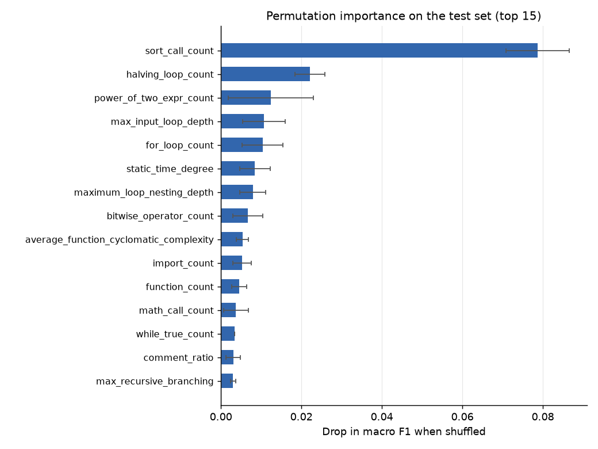
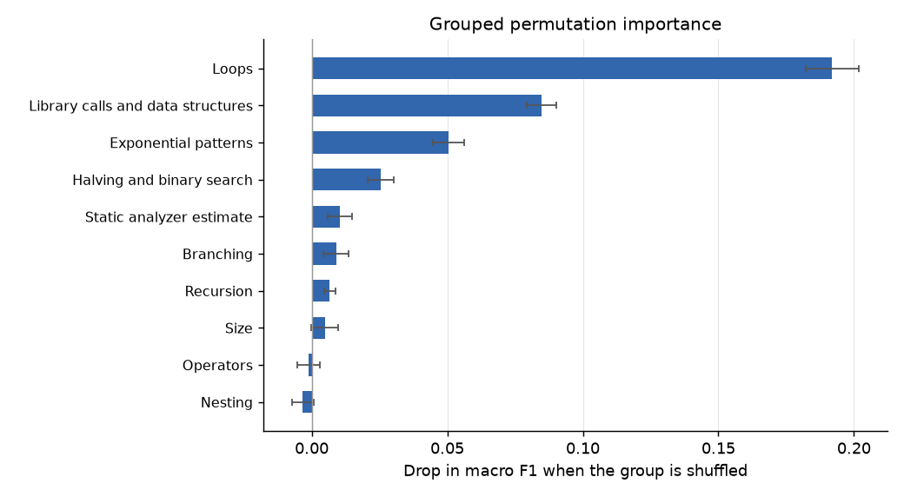

# Model explainability report (Phase 14)

Model: Random Forest, 61 features. Test rows: 814 (grouped by problem, unseen in training). Training rows: 3644. Permutation repeats: 10, seed 42.
Baseline test macro F1 0.460 (matches the saved model metadata).

**Read this first.** Importance shows which inputs this model relies on. It is association, not causation, and the global ranking is not the reason for any single prediction.

## 1. Permutation importance (held-out test set)

Drop in test macro F1 when one feature is shuffled (mean ± std over repeats). `+ repeats` = how many repeats lowered the score.

| rank | feature | group | F1 drop | std | + repeats | strongly correlated with (ρ ≥ 0.8) |
|---|---|---|---|---|---|---|
| 1 | `sort_call_count` | Library calls and data structures | 0.0787 | 0.0079 | 10/10 | - |
| 2 | `halving_loop_count` | Halving and binary search | 0.0221 | 0.0037 | 10/10 | - |
| 3 | `power_of_two_expr_count` | Exponential patterns | 0.0124 | 0.0106 | 8/10 | - |
| 4 | `max_input_loop_depth` | Loops | 0.0107 | 0.0053 | 10/10 | maximum_loop_nesting_depth, nested_loop_count, loop_count |
| 5 | `for_loop_count` | Loops | 0.0104 | 0.0051 | 9/10 | loop_count, maximum_loop_nesting_depth |
| 6 | `static_time_degree` | Static analyzer estimate | 0.0085 | 0.0037 | 10/10 | - |
| 7 | `maximum_loop_nesting_depth` | Loops | 0.0080 | 0.0032 | 10/10 | max_input_loop_depth, nested_loop_count, loop_count |
| 8 | `bitwise_operator_count` | Exponential patterns | 0.0067 | 0.0038 | 10/10 | - |
| 9 | `average_function_cyclomatic_complexity` | Branching | 0.0053 | 0.0015 | 10/10 | average_function_length, maximum_function_cyclomatic_complexity, maximum_function_length |
| 10 | `import_count` | Size | 0.0053 | 0.0023 | 10/10 | - |
| 11 | `function_count` | Size | 0.0045 | 0.0019 | 10/10 | maximum_function_length, return_count, maximum_function_cyclomatic_complexity |
| 12 | `math_call_count` | Library calls and data structures | 0.0037 | 0.0031 | 9/10 | - |
| 13 | `while_true_count` | Loops | 0.0034 | 0.0000 | 10/10 | - |
| 14 | `comment_ratio` | Size | 0.0031 | 0.0018 | 10/10 | comment_lines |
| 15 | `max_recursive_branching` | Recursion | 0.0030 | 0.0006 | 10/10 | recursive_function_count, recursive_call_count |

32 of 61 features change macro F1 by less than 0.002 when shuffled on their own. That does **not** prove they are useless: many have strongly correlated partners that carry the same information.

17 features have a negative mean drop (shuffling them helped slightly on this test set); 14 of them are within one standard deviation of zero. The model gains nothing measurable from these features on unseen problems; for the rest, its use of them seems to hurt slightly.

## 2. Grouped permutation importance

All features of a group shuffled together (same row order), which keeps their correlation inside the group.

| group | features | F1 drop | std | + repeats |
|---|---|---|---|---|
| Loops | 10 | 0.1920 | 0.0098 | 10/10 |
| Library calls and data structures | 6 | 0.0847 | 0.0055 | 10/10 |
| Exponential patterns | 4 | 0.0505 | 0.0058 | 10/10 |
| Halving and binary search | 3 | 0.0255 | 0.0049 | 10/10 |
| Static analyzer estimate | 4 | 0.0103 | 0.0044 | 10/10 |
| Branching | 12 | 0.0090 | 0.0047 | 10/10 |
| Recursion | 5 | 0.0067 | 0.0020 | 10/10 |
| Size | 13 | 0.0048 | 0.0050 | 8/10 |
| Operators | 2 | -0.0011 | 0.0043 | 3/10 |
| Nesting | 2 | -0.0032 | 0.0040 | 2/10 |

Groups with no measurable benefit on unseen problems (mean drop ≤ 0): Operators, Nesting. The forest still splits on these features (see native importance), so they can appear in per-prediction explanations, which flag them. This suggests those splits fit the training problems rather than general patterns. It is a finding about this model, not proof that the features are irrelevant to complexity.

## 3. Which features matter for which class

Mean drop in that class's F1 on the test set when the feature is shuffled (top 3 per class).

| class | test F1 | top features (F1 drop) |
|---|---|---|
| O(1) | 0.453 | `sort_call_count` (0.018), `math_call_count` (0.016), `collection_literal_count` (0.012) |
| O(log n) | 0.474 | `halving_loop_count` (0.149), `for_loop_count` (0.097), `sort_call_count` (0.089) |
| O(n) | 0.438 | `sort_call_count` (0.117), `power_of_two_expr_count` (0.044), `halving_loop_count` (0.013) |
| O(n log n) | 0.621 | `sort_call_count` (0.301), `max_input_loop_depth` (0.015), `nested_loop_count` (0.009) |
| O(n^2) | 0.422 | `power_of_two_expr_count` (0.033), `sort_call_count` (0.030), `identifier_count` (0.023) |
| O(n^3) | 0.405 | `max_input_loop_depth` (0.084), `maximum_loop_nesting_depth` (0.053), `arithmetic_operator_count` (0.049) |
| O(2^n) | 0.410 | `power_of_two_expr_count` (0.067), `bitwise_operator_count` (0.056), `operator_count` (0.014) |

## 4. Native importance (mean decrease in impurity)

From the fitted forest, on the training data. Shown for comparison; it favours features with many distinct values (line and token counts) and is not measured on unseen problems.

| rank | feature | MDI | std across trees |
|---|---|---|---|
| 1 | `max_input_loop_depth` | 0.0633 | 0.0415 |
| 2 | `sort_call_count` | 0.0586 | 0.0235 |
| 3 | `power_of_two_expr_count` | 0.0459 | 0.0282 |
| 4 | `static_time_degree` | 0.0423 | 0.0233 |
| 5 | `maximum_loop_nesting_depth` | 0.0421 | 0.0380 |
| 6 | `arithmetic_operator_count` | 0.0415 | 0.0153 |
| 7 | `for_loop_count` | 0.0411 | 0.0314 |
| 8 | `function_call_count` | 0.0380 | 0.0216 |
| 9 | `unique_identifier_count` | 0.0367 | 0.0186 |
| 10 | `identifier_count` | 0.0349 | 0.0176 |

## 5. Aggregated per-prediction contributions

Mean absolute tree-path contribution toward each test program's predicted class, in vote-share points.

| rank | feature | mean abs. contribution (points) |
|---|---|---|
| 1 | `sort_call_count` | 6.73 |
| 2 | `max_input_loop_depth` | 5.27 |
| 3 | `static_time_degree` | 3.53 |
| 4 | `maximum_loop_nesting_depth` | 3.40 |
| 5 | `power_of_two_expr_count` | 3.32 |
| 6 | `for_loop_count` | 2.93 |
| 7 | `arithmetic_operator_count` | 2.39 |
| 8 | `nested_loop_count` | 2.19 |
| 9 | `loop_count` | 1.94 |
| 10 | `static_time_log_power` | 1.94 |

## 6. Do the methods agree?

Spearman correlation between the feature rankings:

| pair | Spearman (all 61) | shared top-10 features |
|---|---|---|
| native vs permutation | 0.16 | 6/10 |
| native vs aggregated tree-path | 0.955 | 7/10 |
| permutation vs aggregated tree-path | 0.191 | 6/10 |

The Spearman values over all 61 features are dominated by the many features whose permutation importance is near zero (their order is noise), so the top-10 overlap is the more useful comparison. Native importance and tree-path contributions both describe how the trees *use* features (largely on training data); permutation importance describes what *helps on unseen problems*. When they disagree, the second is the safer guide.

SHAP check (shap 0.51.0, 200 test programs): the tree-path method and TreeSHAP share on average 3.9 of their top-5 features for the predicted class; median Spearman correlation of the attributions 0.926.

## 7. Per-prediction explanations

`explain_source(code)` / `explain_features(values)` return, for one program, the base vote share, each feature's contribution toward the explained class (default: the predicted class) and plain-language sentences. Contributions add up exactly to the model's vote share (checked in the tests).

Limitations:

- They explain the model's vote, which is often wrong (test macro F1 about 0.44) and not calibrated.
- The tree-path method credits features by split order; features near the root of many trees tend to get more credit. TreeSHAP (optional) avoids this but needs the `shap` package.
- Correlated features can trade credit between them; read groups (also returned) rather than single features.
- A large contribution is not a cause: changing that feature in the code would not change the code's complexity.

## Caveats

- Feature importance shows which inputs this model relies on; it is association, not causation.
- Global importance is an average over the test set, not the reason for any single prediction.
- Correlated features share importance: a feature can look unimportant because another one carries the same information.
- Native (MDI) importance is computed on training data and favours features with many distinct values.

Software: Python 3.11.18, scikit-learn 1.7.2.
