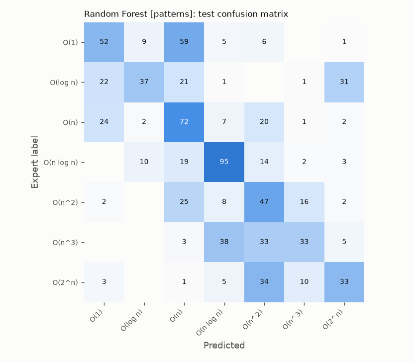
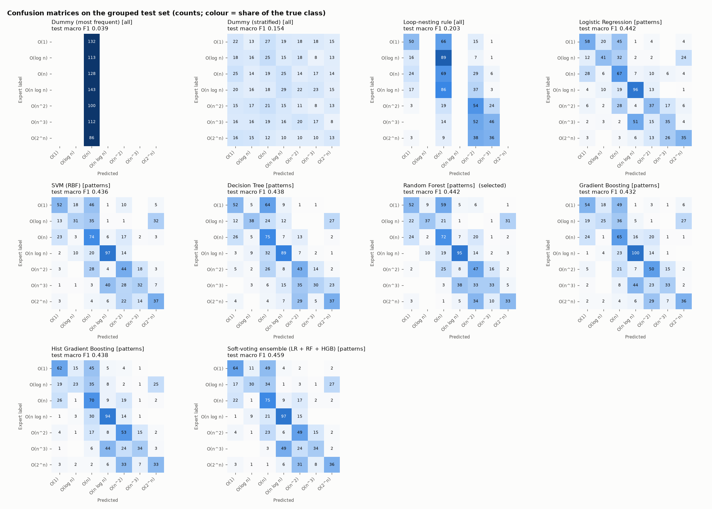

# Model comparison

Generated by `python -m src.train_model`.
Grouped-by-problem partitions: 2,914 train, 730 validation, 814 test rows; no problem appears in two partitions.

**Selection score (RCV):** mean macro F1 over 2×5 repeated grouped cross-validation on train + validation.
**Test:** one evaluation after refitting on train + validation; reported for transparency, not used for selection.
CI = 95% bootstrap interval over test problems. Feature sets: `all` = 39 structural features; `patterns` = those
plus 18 algorithm-pattern features.

| Model | Features | RCV macro F1 | Test macro F1 [95% CI] | Test acc. | Test bal. acc. | Test macro P | Test macro R | Test weighted F1 |
| --- | --- | ---: | ---: | ---: | ---: | ---: | ---: | ---: |
| Soft-voting ensemble (LR + RF + HGB) | patterns | 0.538 ± 0.081 | 0.459 [0.336, 0.560] | 0.473 | 0.461 | 0.499 | 0.461 | 0.467 |
| Random Forest **(selected)** | patterns | 0.536 ± 0.077 | 0.442 [0.320, 0.544] | 0.453 | 0.442 | 0.480 | 0.442 | 0.452 |
| Hist Gradient Boosting | patterns | 0.528 ± 0.078 | 0.438 [0.316, 0.548] | 0.453 | 0.442 | 0.480 | 0.442 | 0.445 |
| Gradient Boosting | patterns | 0.525 ± 0.075 | 0.432 [0.310, 0.542] | 0.446 | 0.436 | 0.470 | 0.436 | 0.438 |
| SVM (RBF) | patterns | 0.520 ± 0.089 | 0.436 [0.321, 0.525] | 0.451 | 0.440 | 0.463 | 0.440 | 0.446 |
| Logistic Regression | patterns | 0.501 ± 0.072 | 0.442 [0.325, 0.523] | 0.453 | 0.441 | 0.456 | 0.441 | 0.450 |
| Decision Tree | patterns | 0.478 ± 0.066 | 0.438 [0.304, 0.542] | 0.447 | 0.438 | 0.481 | 0.438 | 0.446 |
| SVM (RBF) | all | 0.443 ± 0.064 | 0.373 [0.273, 0.466] | 0.375 | 0.374 | 0.398 | 0.374 | 0.373 |
| Soft-voting ensemble (LR + RF + HGB) | all | 0.432 ± 0.057 | 0.380 [0.282, 0.475] | 0.378 | 0.379 | 0.405 | 0.379 | 0.377 |
| Random Forest | all | 0.424 ± 0.053 | 0.361 [0.257, 0.463] | 0.355 | 0.356 | 0.401 | 0.356 | 0.357 |
| Gradient Boosting | all | 0.421 ± 0.061 | 0.354 [0.252, 0.456] | 0.357 | 0.356 | 0.378 | 0.356 | 0.353 |
| Hist Gradient Boosting | all | 0.417 ± 0.049 | 0.364 [0.266, 0.456] | 0.365 | 0.363 | 0.396 | 0.363 | 0.364 |
| Logistic Regression | all | 0.409 ± 0.048 | 0.404 [0.292, 0.476] | 0.405 | 0.406 | 0.404 | 0.406 | 0.404 |
| Decision Tree | all | 0.389 ± 0.039 | 0.323 [0.218, 0.409] | 0.332 | 0.329 | 0.355 | 0.329 | 0.315 |
| Loop-nesting rule | all | 0.265 ± 0.065 | 0.203 [0.117, 0.291] | 0.269 | 0.267 | 0.181 | 0.267 | 0.207 |
| Dummy (stratified) | all | 0.138 ± 0.015 | 0.154 [0.118, 0.164] | 0.156 | 0.153 | 0.155 | 0.153 | 0.157 |
| Dummy (most frequent) | all | 0.046 ± 0.009 | 0.039 [0.022, 0.062] | 0.157 | 0.143 | 0.022 | 0.143 | 0.043 |

Tuned hyperparameters (grouped 5-fold CV on train):

- Soft-voting ensemble (LR + RF + HGB) [patterns]: `{"members": ["Logistic Regression", "Random Forest", "Hist Gradient Boosting"]}`
- Random Forest [patterns]: `{"class_weight": "balanced_subsample", "max_features": "sqrt", "min_samples_leaf": 3}`
- Hist Gradient Boosting [patterns]: `{"l2_regularization": 1.0, "learning_rate": 0.03, "max_leaf_nodes": 31}`
- Gradient Boosting [patterns]: `{"max_depth": 2}`
- SVM (RBF) [patterns]: `{"C": 1.0, "gamma": 0.01}`
- Logistic Regression [patterns]: `{"C": 0.03, "class_weight": "balanced"}`
- Decision Tree [patterns]: `{"class_weight": "balanced", "max_depth": 8, "min_samples_leaf": 10}`
- SVM (RBF) [all]: `{"C": 3.0, "gamma": 0.01}`
- Soft-voting ensemble (LR + RF + HGB) [all]: `{"members": ["Logistic Regression", "Random Forest", "Hist Gradient Boosting"]}`
- Random Forest [all]: `{"class_weight": "balanced_subsample", "max_features": 0.5, "min_samples_leaf": 3}`
- Gradient Boosting [all]: `{"max_depth": 2}`
- Hist Gradient Boosting [all]: `{"l2_regularization": 1.0, "learning_rate": 0.03, "max_leaf_nodes": 15}`
- Logistic Regression [all]: `{"C": 0.01, "class_weight": "balanced"}`
- Decision Tree [all]: `{"class_weight": "balanced", "max_depth": 6, "min_samples_leaf": 5}`

## Effect of the algorithm-pattern features (RCV macro F1)

| Model | Structural only | + pattern features | Change |
| --- | ---: | ---: | ---: |
| Logistic Regression | 0.409 | 0.501 | +0.092 |
| SVM (RBF) | 0.443 | 0.520 | +0.078 |
| Decision Tree | 0.389 | 0.478 | +0.088 |
| Random Forest | 0.424 | 0.536 | +0.112 |
| Gradient Boosting | 0.421 | 0.525 | +0.103 |
| Hist Gradient Boosting | 0.417 | 0.528 | +0.111 |
| Soft-voting ensemble (LR + RF + HGB) | 0.432 | 0.538 | +0.106 |

## Why this model was selected

**Random Forest** with the **patterns** feature set had the highest repeated-CV macro F1 (0.536 ± 0.077); next was Soft-voting ensemble (LR + RF + HGB) [patterns] at 0.538. The rule (highest RCV macro F1; within 0.005, the simpler model) was fixed before any test score was computed.
On the untouched test problems it reached macro F1 **0.442** (95% CI 0.320–0.544), accuracy 0.453, against 0.039 for the majority baseline and 0.203 for the one-feature rule.
The first Phase 10 round (Logistic Regression, structural features, selected on a single validation split) scored 0.404 on the same test problems (+0.038).
Top models' confidence intervals overlap, so the exact ranking among them is not decisive.

Per-class test F1 of the selected model:

| O(1) | O(log n) | O(n) | O(n log n) | O(n^2) | O(n^3) | O(2^n) |
| ---: | ---: | ---: | ---: | ---: | ---: | ---: |
| 0.443 | 0.433 | 0.439 | 0.629 | 0.370 | 0.377 | 0.405 |

## Extra checks

- **Random split:** the selected model scores macro F1 0.740 on a conventional
  stratified random split vs 0.442 on unseen problems; the gap is leakage through shared problems.
- **Without the 13 size features:** test macro F1 0.460 (+0.017); program length is not the main signal.
- **Caveat on the pattern features:** they were designed after inspecting the first round's errors, which were
  measured on this test set. Selection used only cross-validation, but the test score of the new features may be
  slightly optimistic; the repeated-CV score is the fairer estimate.

## What this experiment establishes, and what it does not

- The labels are **expert annotations** (CodeComplex), not thresholds on the inputs, so the score is not circular.
  The structural dataset, whose labels are thresholds, was deliberately not used for training.
- It measures **agreement with those annotators on Codeforces problems the model has never seen**, from static
  features of whole programs.
- It does **not** show accuracy on everyday code, on single functions (labels are per program), or for space
  complexity (no labels exist). Features describe syntax and patterns; they cannot see input sizes or library costs.
- Labels contain noise (identical code with different labels was found in Phase 7), so 100% is not attainable.
- Present the model as a **probabilistic second opinion** next to the rule-based analyser, not as proof.

Software: Python 3.11.9, scikit-learn 1.7.2. XGBoost was not installed, so it was not compared.
